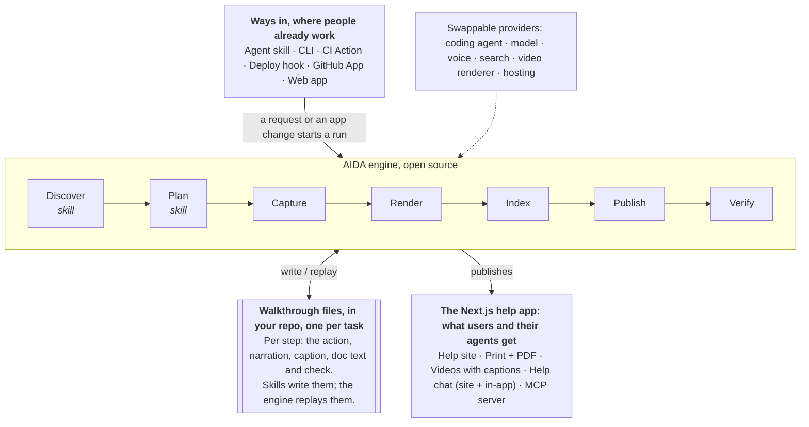
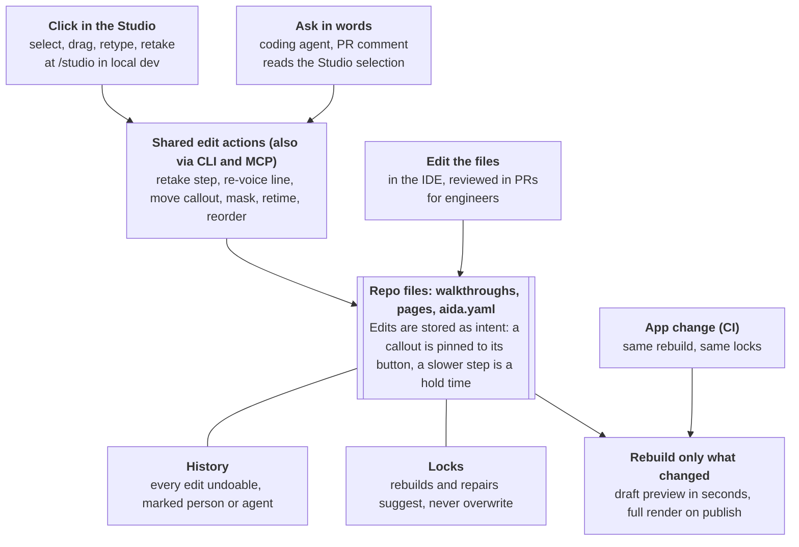
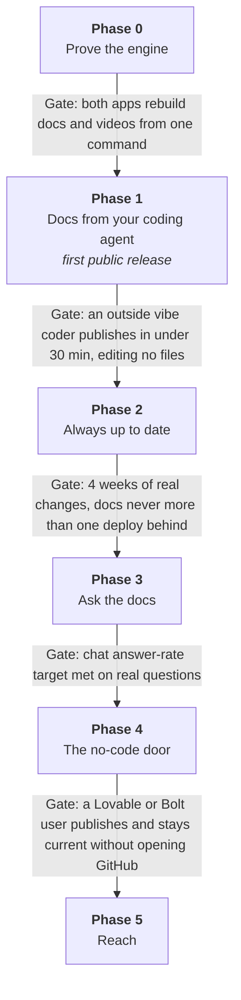

# Self-updating user docs framework — high-level scope

As of 2026-10-26 · **AIDA**: Agent-driven Instruction and Documentation Automation

This file is the scope: the source of truth for what AIDA is for and how it fits together.

## Summary

AIDA points at an app's repo and running app and produces a help centre that keeps itself current: a printable doc site, narrated how-to videos, an AI help chat, and an MCP server other agents can use. A vibe coder should get a published help site in one sitting without opening a config file. An engineer should be able to run it in CI like any other test.

**Pitch:** your app's help centre, written, filmed and kept current by AI, from wherever you already build.

**The gap.** The parts exist separately and closed. Promptless keeps written docs and screenshots fresh, Videate keeps videos fresh, and Mintlify hosts docs with chat and MCP. None starts from the running app, none covers all of it, and all are priced for companies with doc teams. Open-source tools such as Argo cover one slice (Playwright script to video).

**The core idea** comes from a tutorial-video pipeline first built for a pilot app. One walkthrough file per task holds each step's click, narration, caption, doc text and check. The doc page, screenshots, video, captions, tests, chat answers and MCP procedures are all generated from it. Because walkthroughs run against the real app, they double as tests. CI can then tell exactly which docs went stale and rebuild only those.

**How it's delivered.** The user's own coding agent does the work, guided by AIDA's skills and calling the AIDA engine for the repeatable parts. The result is a prescaffolded Next.js help app in the repo, with a local Studio for edits, that deploys like any other Next.js app.

## Who it's for

Two groups build with it and two groups consume what it makes. Vibe coders are the priority, so every default is chosen for them and engineers get the controls underneath.

| Who | Where they already are | What they want | What they must never have to do |
| --- | --- | --- | --- |
| Vibe coder | Lovable, Bolt, v0, Replit, Cursor, Claude Code; deploys on Vercel, Netlify or Supabase | Help docs for their customers without learning doc tooling | Edit YAML, write seed scripts, juggle API keys, set up CI by hand |
| Software engineer | GitHub, PRs, CI, the IDE, Claude Code or Codex, Playwright | Docs as code, reviewed in PRs, deterministic in CI, on their own stack | Adopt a hosted editor or get locked into one vendor |
| The app's end users (for example an organisation's office staff) | The app itself, email, printed sheets | Plain answers, printable steps, short videos, help inside the app | Dig through a developer-style docs site |
| AI agents (users' assistants, support bots, coding agents) | MCP, llms.txt | Current, structured, step-by-step procedures | Scrape HTML pages |

## Design principles

The test for every feature is whether it removes a step for a vibe coder without taking control away from an engineer.

1. **Start from what already exists.** Read the repo, the deployed URL, existing Playwright tests and the app's brand. Infer rather than ask.
2. **Ask at most three plain questions.** Who uses the app? What are the main things they do? How do we sign in? Everything else has a default.
3. **No config on day one.** Config files are generated and committed. Vibe coders never need to open them; engineers can change all of it.
4. **Change it any way you like.** Click it in the Studio, say it ("make the invite video shorter") to the agent or in a PR comment, or edit the file. All three change the same files.
5. **Free first run.** Local voice (Kokoro) and local search by default, so no API key is needed to see first results. Paid providers are a switch.
6. **Preview, then publish.** There is always a preview link before anything goes public, and the first publish needs a person's OK.
7. **Nothing documented that wasn't seen working.** Every step on every page comes from a passing run against the real app. Pages show when they were last checked.
8. **Safe by default.** Fake data, masked personal details, and no writes to production unless explicitly allowed.
9. **One engine, many doors.** A single open-source engine. The agent skill, CLI, GitHub Action, GitHub App and web app are thin front ends on it.
10. **Plain words in the product.** Say "walkthrough", "help site", "help chat" and "agent connector", never "IR", "journey" or "workflow.json".
11. **Good-looking by default.** The site theme is pulled from the app's own colours, logo and fonts, so it looks on-brand with no design work.
12. **Nothing new to install or host.** Node is the only runtime: no Docker. The help site is a prescaffolded Next.js app that deploys like any other: Vercel, AWS Amplify, Netlify, Cloudflare or a Node server.

## Lessons from existing tools

Each tool below proves one part of the idea works. AIDA takes the lesson and combines the parts around one walkthrough file. These notes come from vendor pages and reviews, not hands-on use. More detail: [landscape.md](landscape.md).

| Tool | What it gets right | What AIDA takes | Where AIDA goes further |
| --- | --- | --- | --- |
| [Promptless](https://promptless.ai/) | Listens to PRs, Slack and tickets; tag it on a PR; uses a test account to re-capture screenshots; checks old screenshots on every page it edits | Start work from where it already happens (an @mention on a PR); a test-login quick mode; a staleness check on every edit | Adds video, its own site, chat and MCP; open source |
| [Mintlify](https://www.mintlify.com/docs/ai-native) | Good-looking default theme; docs live in git with a web editor; reader assistant, Search MCP and Admin MCP; Autopilot opens PRs when code makes docs stale | Good looks by default; git as the source of truth with an editor on top; MCP and llms.txt out of the box; agents propose, people approve | User docs captured from the running app, not only from code |
| [Videate](https://www.videate.io/automated-video-production) | Connects at code level, spots UI changes, re-renders videos and screenshots, many languages | Videos rebuilt from replays, never re-recorded by hand; languages later | Open, affordable, any voice provider |
| [Trupeer](https://www.trupeer.ai/tools/auto-updating-documentation-tool), Guidde, Scribe | Anyone can create a guide by clicking through; Trupeer swaps only the changed step | A "Show me" recorder that turns one click-through into a walkthrough; per-step rebuilds | Replays update automatically, so nobody re-records |
| [Argo](https://github.com/shreyaskarnik/argo) (open source) | Playwright script plus a JSON manifest becomes an MP4; local Kokoro voice, no API keys | No-key default; study its manifest before freezing our format | Site, print, chat, MCP and CI |
| [Doc Detective](https://www.docsastests.com/validate-ui-with-doc-detective) (open source) | Docs as tests: runs documented steps against the UI in CI | Walkthroughs are tests; CI flags or repairs docs that disagree with the product | Also writes and films the docs |
| DeepWiki | Swap github.com for deepwiki.com and get a wiki instantly | A URL-swap instant preview for public repos, as a growth hook | Written for the app's users, not its developers |
| HyperFrames (open source) | One HTML source edited by hand, by an agent or in the Studio timeline; the agent reads what's selected; undoable history marked person or agent; plan, sketch and build checkpoints; saved recipes | The Studio, point-and-say edits, history and locks, review checkpoints, house styles | Edits stored on walkthroughs, so they survive every automatic rebuild |

## What it produces

One run produces five outputs from the same walkthroughs, plus the files that keep them current.

- **Help site.** Organised by who the reader is and what they're trying to do: Getting started, How do I…, Screens and settings, Words we use, Troubleshooting and FAQ, and What's new (written from merged PRs). It has search, a version per release, a Markdown copy of every page, and an llms.txt file.
- **Printable guides.** Print-styled pages, a PDF per page, a full manual as one PDF, and one-page quick reference cards. Screenshots are large, with numbered callouts that match the steps.
- **Videos.** One short narrated video per walkthrough (aim for 2 minutes or less), with a chapter per step, captions (SRT and VTT) and a transcript. Short clips of single steps sit inline on the pages. Quality checks proven on the first pilot app are built in: correct colour range, −16 LUFS loudness, no black frames, captions timed to the narration.
- **Help chat.** On the site and as a drop-in widget inside the app (one script tag or a React component). Answers cite the page, show the step's screenshot and jump to the right moment in the video. Inside the app it knows which screen the user is on. Questions it can't answer become suggested new walkthroughs.
- **Agent connector (MCP server).** Hosted with the site and versioned with it. Tools: `search_docs`, `get_page`, `list_walkthroughs` and `get_procedure`, which returns structured steps an agent can follow.
- **Files in the repo.** A `help/` folder holding the Next.js help app with its walkthrough files, pages, config and Studio, plus the CI workflow.

## Ways in

People start AIDA from the tool they already use; they never have to adopt a new one. Every door drives the same engine and writes the same files, so someone can start in the web app and later hand it to an engineer's CI with nothing lost.

| Door | Best for | How it starts | Phase |
| --- | --- | --- | --- |
| Agent skill | Vibe coders and engineers in Claude Code, Codex, Cursor and similar tools | One install line, then "make help docs for my app" | 1 |
| CLI (`npx aida`) | Engineers, scripts | `npx aida init` in the repo | 1 |
| GitHub Action | Teams with CI | Added by `init` or by the agent, in one PR | 2 |
| Deploy hook | People on Vercel, Netlify or Amplify with no CI | Docs refresh against each preview deploy | 2 |
| GitHub App | Lovable, Bolt, v0 and Replit users whose project syncs to GitHub | Install on the repo, then merge a "Set up help docs" PR | 4 |
| Web app | The least technical | Paste the app URL, connect GitHub, add a test login | 4 |
| Generator MCP server | Agents and builders that use MCP but can't run commands | Add the connector, then ask for docs | 4 |
| URL swap | Anyone with a public repo | Swap one part of the GitHub URL for an instant code-only preview | 4 |

### First run: vibe coder in a coding agent

Target: a published help site in under 30 minutes.

1. Runs one install line, then types "make help docs for my app".
2. The agent checks the machine and the app's database (`aida doctor`), reads the repo and suggests who the users are and their top five tasks. It asks one more thing: start the app locally with demo data, or use a test login on the live site?
3. The agent drafts walkthroughs, runs them in a browser and fixes its own failures. A failure that looks like a bug in the app comes to the user instead.
4. It starts the help app and opens the Studio, with screenshots and videos.
5. The user asks for changes in plain words.
6. "Publish it." The agent deploys the help app to their host (Vercel, Amplify, Netlify and so on) and sets up auto-updates, then explains in one sentence what happens on future changes.

### First run: Lovable or Bolt user in the web app

1. Signs in with GitHub and picks the project's repo, or pastes only the app's URL.
2. Creates a test login using a short checklist and pastes it in.
3. Approves the suggested walkthroughs as cards: rename, remove, or add a "How do I…".
4. Watches the build live, reviews the preview, and fixes things by chatting or clicking on the text.
5. Publishes to a free subdomain or their own domain.
6. Copies a ready-made prompt into their builder that adds a Help button to the app.
7. From then on gets emails like "4 guides updated after your last change; 1 needs your OK".

### First run: engineer

1. Runs `npx aida init`. It detects the framework, routes, sign-in method and existing Playwright tests.
2. Commits the scaffolded `help/` app and a GitHub Action in one PR.
3. Every app PR now gets a docs check comment, and every merge publishes.

## How it works

The user's coding agent does the judgment work, using AIDA's skills. The AIDA engine, an npm package that both the agent and CI call, does the repeatable work. The output is a prescaffolded Next.js help app, and the walkthrough files inside it are the single source of truth.



Skills (judgment) handle Discover and Plan; the engine stages give the same result every run.

Whichever door starts a run, the same engine replays the walkthrough files, and every output is built from them.

### The help app

`npx aida init` scaffolds a Next.js app into a `help/` folder in the user's repo, or into its own repo. Everything readers see, and the Studio, lives in it.

```
help/                      prescaffolded Next.js app
├── aida.config.ts         app URL, readers, voice, host
├── walkthroughs/*.yaml    one per task, the source of truth
├── content/               generated pages + hand-written parts
├── public/                screenshots, PDFs (videos go to blob storage)
└── app/
    ├── (site)/            help site, print styles, llms.txt
    ├── api/chat/          help chat
    ├── api/mcp/           MCP server
    └── studio/            Studio: local dev only, never deployed
```

| Part | Does | Runs where |
| --- | --- | --- |
| Coding agent with AIDA skills | Reads the repo, plans walkthroughs, writes pages, fixes failures, makes requested changes | The user's coding environment |
| AIDA engine (npm package) | Capture, voice, video render, PDFs, search index, checks; the same result every run | The coding environment and CI, never the host |
| Help app (Next.js scaffold) | The site, chat, MCP server and Studio | Local dev for the Studio; the user's host for the rest |
| Host | A plain `next build`; no Playwright or FFmpeg | Vercel, Amplify, Netlify, Cloudflare, any Node server |

The app stays thin: the logic lives in the engine package, so `aida upgrade` can update a scaffold without touching the user's content.

### Walkthrough files

One file per task a user does. Steps are written in plain words using the names people see on screen. The engine turns those into Playwright role and label locators, which survive most redesigns. Format: human-readable YAML checked against a JSON Schema (an open decision below). The first pilot app's `workflow.json` was the v0 baseline.

```yaml
walkthrough: add-member
title: Add a new member
for: office-staff
start: { signed_in_as: office-staff, page: /members }
steps:
  - do: click "Add member" button
    say: Start by selecting Add member.
    page_text: Select **Add member** at the top right.
  - do: fill "First name" with "Jordan"
    say: Type their first name.
  - do: click "Save" button
    check: text "Member added" is visible
    say: Save, and they're ready to book a session.
```

Each step can also carry a caption, callouts and fields to mask.

**Data a walkthrough needs and changes.** Most tasks save something, so walkthroughs depend on each other. Each file says so with named data states: `needs: [session-full]`, `leaves: [alex-on-waitlist]`, `clears: [alex-in-morning]`. Starting data that no walkthrough leaves ("Alex is in the morning block") is a state in `aida.config` with a `setup` hook that puts it in through the app's own API and a `check` hook that says whether it's there, so a walkthrough can be captured on its own, and twice. Data only one walkthrough uses goes in its own `setup:` steps, which run before capture and are never filmed. `{{run.id}}` names records that setup creates, and never appears on screen. The engine works out the capture order from these; `aida order` shows it.

**Who it signs in as.** One persona per walkthrough: `signed_in_as` is shorthand for the persona's role, and the two can't disagree. A `roles` map in the config gives each role the name readers see ("Sign in as an organiser").

**The outline.** The planned walkthroughs live as cards in `outline.yaml`, each with who it's for, its section and the on-screen names it promises. After a passing capture the engine compares those names with what was really on screen and records any difference on the card, so the plan and the app don't quietly drift apart.

### Pipeline

1. **Discover** (agent skill). Read routes, roles, features and labels, and draft a glossary.
2. **Plan** (agent skill). Pick the readers and their top tasks, lay out the site as outline cards, and write the walkthroughs.
3. **Capture.** Replay each walkthrough in a browser against the app, in the order their data implies, saving screenshots, video, and what each step touched (routes, API calls, components). A failure is classed as the walkthrough's, the app's or the environment's, with what changed after the failing action as evidence.
4. **Render.** Build pages, print styles and PDFs, narrated video and captions.
5. **Index.** Build search, embeddings and the step-by-step procedures for chat and MCP.
6. **Publish.** Deploy the site, chat and MCP server.
7. **Verify.** Quality, personal-data and secret checks before anything goes live.

### Capture modes: a ladder from quick to safe

| Mode | What the user gives | How data stays safe | Good for |
| --- | --- | --- | --- |
| Preview or live URL (default) | The app's URL and a test account | Sample data is created through the app's own screens in a demo account; asks before saving anything else; masks personal details | Most apps; nothing to install |
| Local | Nothing: AIDA starts the app's own `npm run dev` | A database branch (Supabase, Neon) when there is one, otherwise the demo-account approach | Engineers, apps with no previews |
| CI | Nothing more | Each PR's preview deploy (Vercel, Netlify, Amplify), or the app started on the CI runner; throwaway data per run | Auto-updates |

Sign-in happens once with the test account, then the saved session is reused. Helpers cover Auth.js, Clerk, Supabase Auth and Firebase; `init` writes the Auth.js one, which mints a session cookie for a local app using JWT sessions. Demo data goes in through the app's own screens or API (setup steps and state hooks), so AIDA needs no database access; the agent writes a seed script only when an engineer wants one. Local capture runs against a production build of the app (`next build && next start`), not the dev server. Before any capture, `aida doctor` checks the machine, the app's address and its database. A repo that already runs on `docker compose` can use it, but Docker is never required. When the agent can't work a flow out, the "Show me" recorder (`aida record`) lets the user click through once in a browser window, signed in and set up exactly as capture would be, and turns that into a draft walkthrough: targets by on-screen names, checked against the page as they're recorded, typed values swapped for safe demo data, then replayed once to show it works.

### Working with any agent

1. **Engine.** TypeScript, run with `npx`. Does capture, render, index, publish and checks, the same way every time.
2. **Skills.** Agent Skills format (`SKILL.md`), plus an `AGENTS.md` that points to them. Claude Code and Codex read these natively. The skills cover discover, plan, write, demo data and repair.
3. **Generator MCP server.** The same engine actions for clients that speak MCP but can't run commands.
4. **Built-in agent loop.** Where no coding agent is present (the web app, CI), the engine runs the same skills itself through any model adapter.

### Swappable providers

| Kind | Default (free or local) | Options |
| --- | --- | --- |
| Voice | Kokoro, local | ElevenLabs, OpenAI, MiniMax, Azure, Google, Cartesia |
| Model (planning, chat) | The user's coding agent; Ollama for local | Anthropic, OpenAI, Google, OpenRouter |
| Search | Built in: an index file that ships with the help app; no database | Supabase pgvector, Upstash Vector or Cloudflare Vectorize for big sites |
| Video renderer | AIDA's own HTML player plus FFmpeg (proven) | HyperFrames (an open decision) |
| Hosting | The user's own host, as a Next.js app | Vercel, AWS Amplify, Netlify, Cloudflare, any Node server; static export for GitHub Pages or S3; AIDA Cloud |
| Video storage | With the site when small | The host's blob storage (Vercel Blob, S3, Netlify Blobs, R2, Supabase Storage), Mux, unlisted YouTube |

### Runs on Node, deploys like any Next.js app

Everything installs with `npx`: Playwright's pinned Chromium, FFmpeg from npm, and no Docker. That also keeps it working inside cloud coding-agent sandboxes, which often can't run Docker. `aida doctor` checks Node, FFmpeg, the browser and its libraries, disk space and the help app install, with the fix for each problem.

Until the engine is published to npm under a package name of its own, the help app depends on a packed copy of the engine's runtime in `help/vendor/`, never a bare package name; `init` packs and installs it. The capture, video and PDF tools stay out of it, so the host installs only what the site needs.

Capture, voice, video and PDFs run in the coding environment or CI, never on the host. Videos are uploaded to blob storage, and the host only runs a normal `next build`. Chat and the MCP server are ordinary Next.js routes in the same app, so there is one project and one deploy.

| Host | What works | How |
| --- | --- | --- |
| Vercel | Everything | Import the `help/` folder as a project |
| AWS Amplify | Everything | Amplify Hosting's Next.js support, app root `help/` |
| Netlify | Everything | Netlify's Next.js support |
| Cloudflare | Everything | The OpenNext Cloudflare adapter |
| Any Node server | Everything | `next start` |
| GitHub Pages, S3 or any static host | Site and search; no chat or MCP | Static export |

`aida publish --to <host>` writes the host's settings and deploys through the host's own CLI or Git integration. Videos go to that host's blob storage (Vercel Blob, S3, Netlify Blobs, R2).

**A separate app by default.** The help app sits next to the user's app, not inside it, so it never touches their code and works whatever their app is built with. For `yourapp.com/help`, add a rewrite on the app's host, or use Next.js multi-zones when the app is also Next.js.

## Editing

People can change anything they see in three ways: click it in the AIDA Studio, ask for it in words, or edit the file. All three make the same change to the same repo files. This follows HyperFrames, where the Studio, the agent and a hand edit all change one HTML source, so nobody is locked into one tool.



### The Studio

The Studio is a page inside the help app that only exists in local dev: run `npm run dev` and open `/studio`. It is never part of the production build, and it edits the repo's files directly, the way Keystatic and TinaCMS work. It has a live preview of the page or video, the walkthrough's steps down the side, and page text editable in place. Under the video sits a timeline with one row per kind: screen, narration, captions and music. As in HyperFrames, one row per kind keeps the timeline short enough for a non-editor to read.

In a remote coding environment the dev port is forwarded, the way HyperFrames Studio is reached on a server. Off localhost the Studio opens only on a host listed with `aida init --tunnel-host`, and only after a private access link sets its key, because whoever can reach it can edit the help app's files. Where a sandbox can't expose ports, the same Studio can run on a preview deploy behind sign-in and commit edits to GitHub. That is also the route to a hosted Studio in Phase 4, without building a separate cloud editor.

| What | In the Studio | Asked in words (example) |
| --- | --- | --- |
| Steps | Reorder, add, remove, retake one step | "Skip the sign-in step in the video" |
| Narration and captions | Edit the text, re-voice one line, set how a word is said | "Say SQL as 'sequel'" |
| Screenshots | Crop, numbered callouts, blur boxes, zoom target | "Blur the email address in step 3" |
| Video pacing | Hold time per step, speed, music on or off, intro and outro cards | "Make the invite video shorter" |
| Page text | Edit any paragraph, including generated step text | "Explain why a booking needs a session first" |
| Site | Page order, titles, theme, logo | "Put Payments before Reports" |
| Voice | Voice, speed and accent per site or walkthrough | "Use an Australian voice" |
| Help chat | Suggested questions, tone, support contact | "Send questions it can't answer to support" |

Engineers make the same changes in the walkthrough files, page Markdown and `aida.yaml`, and review them in PRs.

### How edits stay safe

- **Edits are stored as intent, not pixels.** A callout is pinned to the button it points at, not to x and y. A slower step is a hold time on the walkthrough. So every rebuild keeps the edit, even after the UI moves.
- **Point and say.** Select a step, callout or clip in the Studio, then tell the agent "make this slower". The agent reads the Studio's current selection instead of guessing, as HyperFrames does.
- **History.** Every edit is an undoable entry, marked as made by a person or by the agent. At the start of a turn the agent reads what the person changed since its last turn and builds on it. "Undo the agent's last turn" leaves the person's edits alone.
- **Locks.** Lock a line of narration, a screenshot, a page section or a whole walkthrough. Rebuilds and agent repairs never change locked items; they suggest a change instead.
- **One set of edit actions.** Studio buttons, the agent, the CLI (`aida edit`) and the generator MCP server all use the same small set of actions: retake a step, re-voice a line, move a callout, mask, retime, reorder. Results match whichever surface made them.
- **Checked and quick.** Every edit is validated, and only what it touched re-renders, as a fast draft preview. Full quality renders on publish.
- **Hand-off both ways.** The agent can open the Studio for the person. When they come back, `aida catch-up` tells the agent what changed in the Studio.

### Review checkpoints

Modelled on HyperFrames' plan, sketch, build loop, so big changes are cheap until the end.

1. **Outline.** The suggested walkthroughs as cards to approve, rename or remove.
2. **Step sheet.** Each walkthrough as screenshots plus narration text, with no video yet, and any outline card whose promised names differ from the screen. Changes here cost almost nothing.
3. **Build.** Videos, pages and chat, reviewed in the Studio preview.
4. **Publish** on approval.

Cosmetic CI updates skip these checkpoints, as set out in Keeping docs current.

### House styles

An approved setup (voice, pacing, intro and outro, theme, page structure) can be saved as a house style, as HyperFrames saves recipes. The next app then starts from it: "make docs like last time". This matters for anyone producing docs for many apps, such as a done-for-you service.

### Where HyperFrames Studio fits

AIDA renders through its own HTML player and FFmpeg, ported from the pilot app's pipeline. If AIDA builds videos as HyperFrames compositions instead (an open decision), then for one-off polish, such as a marketing cut, "Open in HyperFrames Studio" exports a copy for full timeline editing. That copy is a fork: it doesn't auto-update. Whether the AIDA Studio builds its own timeline or reuses HyperFrames Studio's is an open decision.

## Keeping docs current

Every app change re-runs only the walkthroughs it touched, publishes cosmetic updates on its own, and asks a person only when meaning changes.

### When it runs

- **App PR opened.** Re-capture the affected walkthroughs against the PR's preview deploy (or an app the CI runner starts) and post screenshot diffs, a list of stale pages and a preview link as a PR comment. No video render, so it stays fast and cheap.
- **Merge or deploy.** Rebuild what changed and publish it as the latest version.
- **Release tag.** Freeze a versioned copy. Chat and MCP answer for that version.
- **Nightly.** A full check for drift, broken links and missing assets.

People without CI get the same behaviour from the deploy hook or the GitHub App.

### Only rebuild what changed

- **Impact map.** Capture records the routes, API calls and components each step touches. A diff then names the affected walkthroughs. If the map can't tell, everything runs.
- **Caching by content.** Unchanged narration reuses its audio, so it costs nothing. A screenshot that moved less than a set threshold is kept. A video re-renders only if one of its scenes changed.
- **Repeatable runs.** The Playwright version pins the browser. A fixed window size, locale and time zone, Playwright's fake clock, seeded data and reduced motion do the rest, with no Docker. Published captures always come from the same CI runner type; local runs are previews. Diffs then show real changes, not noise.

### Three kinds of change

| Kind | Example | What happens | Who's asked |
| --- | --- | --- | --- |
| Cosmetic | A button moved or restyled; the flow is the same | Screenshots and video refresh and publish | Nobody |
| Broken | A step can't find its button or a check fails | The PR comment flags it with the command to run; Claude Code repairs the walkthrough, re-runs it and opens a docs PR (locally, or in CI through the optional Claude Code GitHub Action) | Author of the app PR |
| New | A new screen no walkthrough covers | Claude Code drafts a new walkthrough and page as a PR labelled `docs:new` | Author of the app PR |

A failure that looks like the app's fault, such as a save that succeeded while the screen stayed the same, a server error or a blank page, isn't a broken walkthrough. The PR comment lists it apart under "Possible app bugs" with its evidence and no repair command, and the docs are never changed to work around it.

### Human edits are never overwritten

Each page mixes generated blocks (built from walkthroughs) and blocks a person wrote. A rebuild rewrites only the generated blocks. If a person's text looks out of date, the agent suggests a change instead of making it. Narration a person reworded is pinned until they unpin it.

### Approvals where people already are

- **Engineers** review the docs PR like any other.
- **Vibe coders** get an email or Slack message with Approve and "Fix it" buttons.
- **Anyone** can tag `@aida` on a PR or issue to ask for a change.

CI itself uses no model and no API key: it maps the diff, re-captures and diffs screenshots, and comments. Judgment work runs through Claude Code on the user's own plan, so there is no per-run dollar cap. Screenshot diffs live on an `aida-previews` branch in the app repo so the PR comment can show them inline.

## Safety and trust

Docs go public, so nothing real should reach them by accident. The first pilot app showed the risk: its training copy held real customer names.

- **Production data.** Never written by default. Quick mode asks before any step that saves, and recommends a separate demo account or workspace. Write steps run only against local or preview environments unless explicitly allowed.
- **The app's database, not only its address.** An app on `localhost` can still write to a live database. Before capture, AIDA reads every database setting the app may start with: its env files up to the repo root, the process environment and the config, by name and by value. A setting off this machine, or one it can't read, stops the run. The fix is a Neon or Supabase branch or a local database. A person can name one exact database as a throwaway copy, or one exact setting the capture server doesn't use; neither carries over to another database.
- **Messages and payments.** A live payment key stops capture unless that exact setting is allowed. Real email or SMS senders bring a warning until the owner confirms the app sends nothing during capture.
- **Personal details.** Demo data uses example.com emails and phone numbers from ranges reserved for fiction. Names, emails and phone numbers are masked in screenshots and video at page level, before capture. Every output is scanned for personal data before publishing.
- **Secrets.** Test logins and API keys live in CI or host secrets, never in the repo or the output. Every output is scanned for secrets.
- **App bugs stay visible.** A capture failure that looks like a bug in the app goes to a person with its evidence; agents never write around it.
- **Truthfulness.** A page can't publish unless every step on it passed against the real app. Each page shows when it was last checked. Chat answers only from the docs, cites its source, and says when it doesn't know, pointing to support.
- **First publish.** Always approved by a person.
- **Access.** The MCP server is read-only. The Studio off localhost needs a listed host and a private access key. Private docs behind sign-in come later.

## Token efficiency, models and subagents

Model tokens are the main running cost, and a long agent context also makes weaker agents fumble. AIDA spends tokens only on judgment, picks the cheapest model that does each job well, and splits big jobs across subagents so no single context fills up.

**Spend tokens only on judgment.** Capture, voice, render, index, checks and publish are engine code and use no model tokens. A run where nothing changed costs nothing: content hashes skip unchanged walkthroughs, narration and pages before any model is called.

**The right model for each job.** Models come in three tiers, set once in `aida.config.ts` and mapped to whatever provider the user has. Defaults on Anthropic: fast = Haiku 4.5, standard = Sonnet 5, deep = Opus 5.5.

| Tier | Jobs | Why this tier |
| --- | --- | --- |
| Fast | Change-tier triage in CI, glossary and label extraction, caption shortening, personal-data second look, help chat answers from retrieved pages, route summaries in Discover | Short, structured, high volume |
| Standard | Writing walkthroughs and page text, repairing a failed step, demo-data scripts, Studio "ask in words" edits | Needs care with the app's real names and flow |
| Deep | Picking readers and top tasks for a new app, repairs the standard tier failed twice, "New" tier drafts | Rare, high-stakes planning; escalation only |

Each skill names its tier, so a coding agent can run it with the matching model (Claude Code subagent definitions ship with a `model:` line). Where the user's agent can't switch models, everything runs on its one model and still works.

**Subagents keep contexts small.** The main agent orchestrates and holds only short summaries.

- **Discover** fans out one read-only subagent per area of the app (route group or feature). Each returns a compact summary: routes, roles, on-screen labels, likely tasks.
- **Write and repair** run one subagent per walkthrough, in parallel, each seeing only its walkthrough, the glossary, the style guide and its own capture report.
- **Review** runs in a fresh subagent that sees the output, not the reasoning that produced it.

**The engine feeds agents small inputs.** Commands print a short summary by default and JSON with `--json`. A failed step reports the step, the error, and a trimmed accessibility snapshot of the page, never full HTML or logs. `aida digest` gives a compact map of routes, roles and labels so an agent doesn't read the whole repo. Skills stay short and load reference files only when needed.

**Caching and budgets.** Stable prompt parts (style guide, glossary, schema) come first so provider prompt caching applies. Each run reports tokens per stage and model. Model work runs through Claude Code, not API keys.

## Scope by phase

Six phases, each finished only when its gate passes with a real app or a real user. v1 means Phases 0 to 3: the full engine and every output, reached through the agent, CLI and CI doors. Phase 4 adds the no-code doors.



| Phase | What ships |
| --- | --- |
| 0 · Prove the engine | Pull the first pilot app's tutorial pipeline into a standalone engine. Walkthrough format v0, voice adapters (Kokoro, MiniMax, ElevenLabs), video quality checks. Run it on that app plus one more. |
| 1 · Docs from your coding agent | Skills for Claude Code, Codex and Cursor; the AIDA engine; the Next.js help app scaffold with print, PDF, video, search and an on-brand theme. Studio at /studio in local dev. Node only, no Docker. Deploys to Vercel, Amplify, Netlify, Cloudflare or any Node server. |
| 2 · Always up to date | GitHub Action, PR check with screenshot diffs, deploy-preview hooks, three change tiers, agent repair. Studio timeline, callouts and blur boxes, edit history and locks. Playwright test import, versioned docs. The "Show me" recorder from the command line (`aida record`). |
| 3 · Ask the docs | Help chat on the site and inside the app, MCP server with step-by-step procedures, unanswered questions turned into suggested walkthroughs. |
| 4 · The no-code door | Web app, Studio on preview deploys behind sign-in, GitHub App, "Show me" recorder in the hosted Studio, email approvals, hosted rendering, voices and hosting. Ready-made Help-button prompts for Lovable, Bolt, v0 and Replit. |
| 5 · Reach | Other languages, voice questions and answers, in-app guided tours built from walkthroughs, mobile apps, private docs behind sign-in, export to Mintlify or Docusaurus. |

If Lovable and Bolt users are the first target, the GitHub App moves forward from Phase 4 to sit alongside Phase 2 (see Open decisions).

### Out of scope for v1

- Native mobile and desktop apps (web apps only)
- API or developer reference docs (link out to existing tools; OpenAPI import later)
- In-app guided product tours
- Languages other than English
- Voice Q&A with the help chat
- Private docs behind sign-in or SSO
- Analytics dashboards
- The Studio outside local dev (in v1 it runs in the coding environment; on preview deploys behind sign-in in Phase 4)

## Success measures

These are proposed targets, to be confirmed after Phase 0 measures real numbers.

| Measure | Target | Phase |
| --- | --- | --- |
| Time from install to a published help site (vibe coder, agent door) | Under 30 minutes | 1 |
| Files the user edits by hand on the first run | 0 | 1 |
| API keys needed to see the first preview | 0 | 1 |
| Walkthroughs that pass on their first capture | 80% or more | 1 |
| How far docs lag the app | Never more than one deploy | 2 |
| Updates published with no person involved | 70% or more | 2 |
| PR check time for a typical change | Under 5 minutes | 2 |
| Chat questions answered with a citation | 80% or more | 3 |
| Running cost for an app with 20 walkthroughs | Measured in Phase 0, then capped | 0 |
| Model tokens for a CI run where nothing changed | 0 | 2 |
| Model tokens per walkthrough, first run and per cosmetic update | Measured in Phase 0, then a target | 0 |

## Risks

The biggest risk is capture failing on real apps. The demo-environment work and agent repair are there mainly to handle it.

| Risk | Why it matters | Mitigation |
| --- | --- | --- |
| Capture breaks on real apps (two-factor sign-in, captchas, flaky UI, animations) | No capture, no docs | Test-only sign-in in demo environments, saved sessions, retries, agent repair, repeatable-run settings |
| Demo data is too hard for vibe coders | They stall at setup | The agent writes it; quick mode as a stepping stone; helpers for preview deploys and Supabase branches |
| Quick mode touches real customer data | Privacy breach in public docs | Mostly reads, asks before saving, masking, personal-data scan, first publish approved by a person |
| Generic AI writing | Docs nobody trusts | Text grounded in captured steps, written per reader, plain-language style guide, people review text changes |
| Docs describe things that don't exist | Wrong instructions | A page publishes only if all its steps passed |
| Weaker agents fumble the skills | Results vary by tool | The engine does everything repeatable; skills stay short and are tested against Claude Code and Codex |
| Model, voice and render costs | Free tier becomes expensive | Caching by content, local defaults, budget caps, video only on merge, model tiers, small engine outputs, subagents per walkthrough |
| A rebuild overwrites a person's edits | Lost work, lost trust | Generated and human blocks kept apart; suggestions, not overwrites |
| Incumbents add the missing parts (Mintlify adds video, Promptless adds a site) | Gap closes | Open source, one walkthrough file for everything, vibe-coder distribution, self-hosting |
| The Studio grows into a big build | Delays v1 | Phase 1 Studio edits walkthrough fields and page text only; timeline, callouts and blur boxes in Phase 2; reuse HyperFrames Studio where it fits |
| Screenshots differ between machines without a pinned image | Noisy diffs, false updates | Publish only from CI on one runner type; local runs are previews; a diff threshold |
| A host can't run the chat function (GitHub Pages) | No help chat or MCP | Site search still works; run the function on another host or AIDA Cloud |
| The scaffold falls behind new Next.js releases | Help apps break on upgrade | Pinned versions; a thin app with the logic in the engine package; `aida upgrade` updates scaffolds |
| The Studio can't be reached from a remote or sandboxed coding environment | No visual editing | Port forwarding; the Studio on a preview deploy behind sign-in; edits by asking still work |

## Open decisions

The first two decide the order of everything else. Tracked in [decisions.md](decisions.md).

| Decision | Options | Recommendation |
| --- | --- | --- |
| Business model | Open-source engine plus paid cloud; a done-for-you service; internal tool first | Open-source engine now, done-for-you service for early clients, paid cloud once Phase 2 holds up |
| First target user | Vibe coders in Cursor or Claude Code (agent door first); Lovable and Bolt users (GitHub App first) | Agent door first: cheapest to build, and the same people can try it |
| Walkthrough format | YAML with a schema; Markdown with step notes (Doc Detective style); JSON (Argo style) | YAML with a schema, after comparing with Argo and Doc Detective |
| Docs layer in the Next.js help app | Fumadocs; Nextra; custom | Fumadocs (built for the Next.js App Router); check print support in Phase 1 |
| Who pays for chat on free sites | Owner brings a key; cloud credits; local model only | Owner brings a key when self-hosting; credits in the cloud |
| Licence | Apache-2.0; MIT; source-available | Apache-2.0 |
| Second app to test on | Another app in the workspace; a friendly client's app | One app with a different stack from the first pilot app |
| Video timeline in the Studio | Build AIDA's own; embed or extend HyperFrames Studio; only export to HyperFrames Studio for one-off polish | Export-only in Phase 1. Before Phase 2, test whether HyperFrames Studio can be embedded with walkthrough-aware edits; if not, build a simple one-row-per-kind timeline |
| Video renderer | AIDA's own HTML player (ported from the pilot) plus FFmpeg; HyperFrames compositions | Keep that player for Phase 0; switch to HyperFrames only if its Studio or renderers earn it, decided with the timeline question |

## Sources

- [Promptless](https://promptless.ai/) and its [docs overview](https://promptless.ai/docs/for-docs/start-here/welcome)
- [Mintlify: AI-native documentation](https://www.mintlify.com/docs/ai-native)
- [Videate: automated video production](https://www.videate.io/automated-video-production)
- [Trupeer: auto-updating documentation](https://www.trupeer.ai/tools/auto-updating-documentation-tool)
- [Scribe alternatives compared (Ferndesk)](https://ferndesk.com/blog/scribe-alternatives)
- [Argo on GitHub](https://github.com/shreyaskarnik/argo)
- [Doc Detective: validate a UI](https://www.docsastests.com/validate-ui-with-doc-detective)
- [Best codebase documentation tools for AI agents (repowise)](https://repowise.dev/blog/comparisons/best-codebase-documentation-tools-ai-agents)
