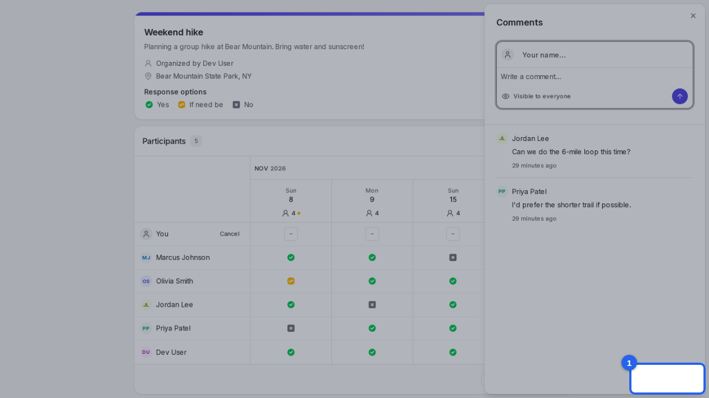
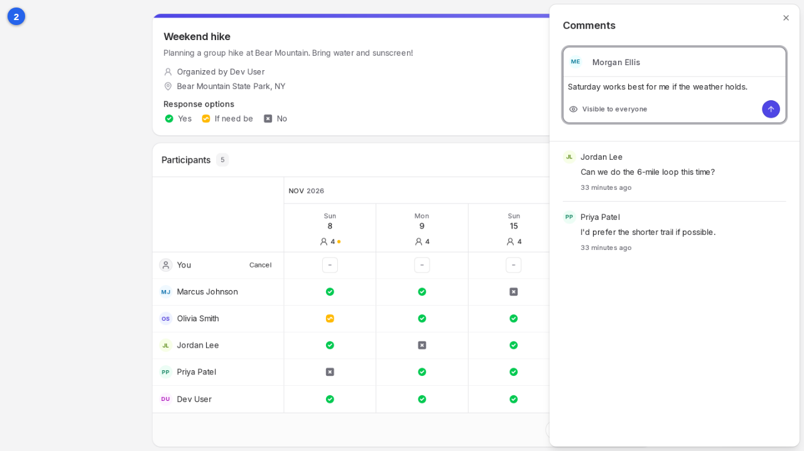
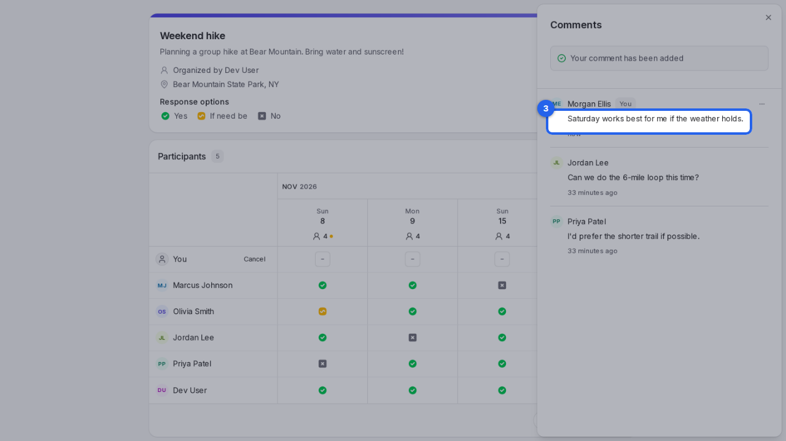

{/* aida:begin header */}
# Leave a comment on a poll

Ask a question or add a note for the organizer and everyone else on the poll. This guide is for people invited to a poll.
{/* aida:end header */}

{/* aida:begin steps-heading */}
## Steps
{/* aida:end steps-heading */}

{/* aida:begin step-open-comments */}
#### 1. Open the comments

On the poll, select **Comments** in the bottom corner.

{/* aida:end step-open-comments */}

{/* aida:begin step-write-comment */}
#### 2. Write your comment

Type your name in **Your name**, then your comment in **Write a comment**. Comments are visible to everyone on the poll.

{/* aida:end step-write-comment */}

{/* aida:begin step-post-comment */}
#### 3. Add the comment

Select **Add comment**. Your comment shows in the list straight away.

{/* aida:end step-post-comment */}

{/* aida:begin last-checked */}
---

*Steps verified against the real app on 2026-10-28.*
{/* aida:end last-checked */}
