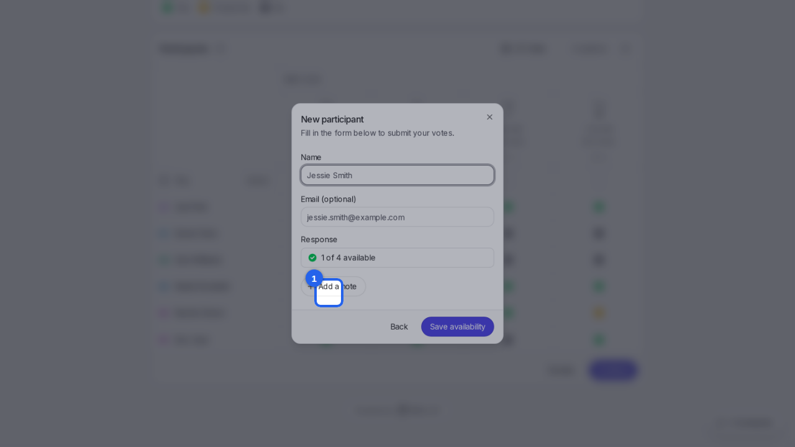
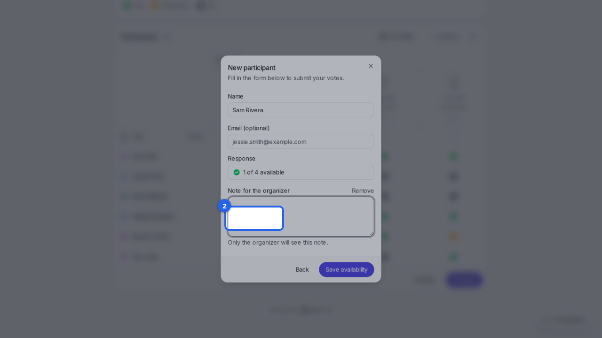
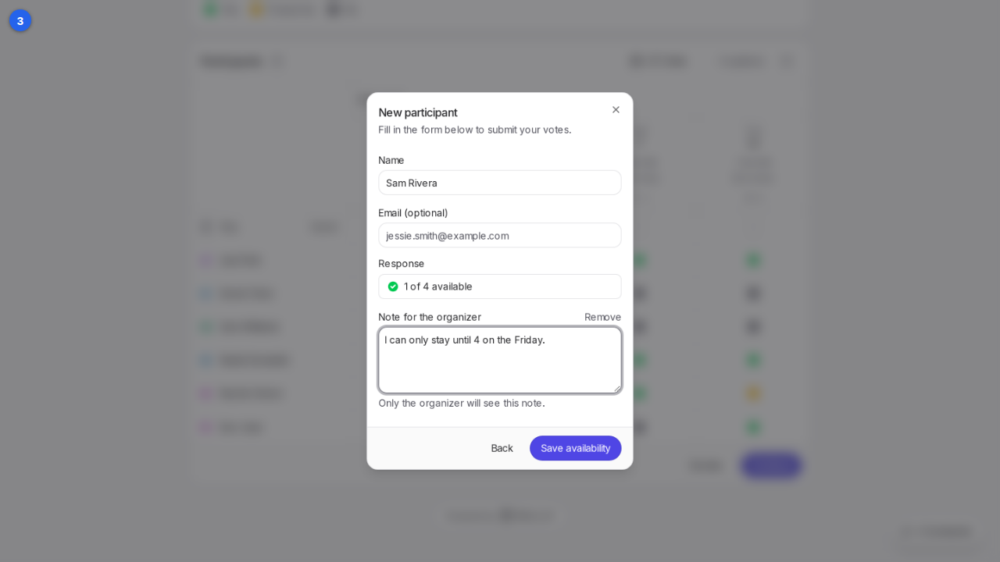
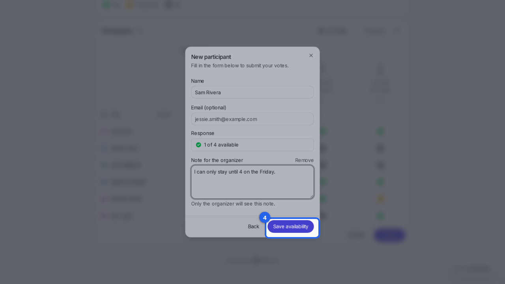

{/* aida:begin header */}
# Add a note to your answer

Explain your answers, like when you can only stay for part of the time. This guide is for people invited to a poll.
{/* aida:end header */}

{/* aida:begin steps-heading */}
## Steps
{/* aida:end steps-heading */}

{/* aida:begin step-mark-dates */}
#### 1. Mark your dates

Mark the dates that work for you in the **You** row, then select **Continue**.

{/* aida:end step-mark-dates */}

{/* aida:begin step-open-note */}
#### 2. Add a note

Type your name in **Name**, then select **Add a note**.

{/* aida:end step-open-note */}

{/* aida:begin step-write-note */}
#### 3. Write your note

Type your note in **Note for the organizer**. Only the organizer sees it, not the other people on the poll.

{/* aida:end step-write-note */}

{/* aida:begin step-save */}
#### 4. Save your availability

Select **Save availability**. The organizer sees a note icon next to your name and can read it there.

{/* aida:end step-save */}

{/* aida:begin last-checked */}
---

*Steps verified against the real app on 2026-10-28.*
{/* aida:end last-checked */}
