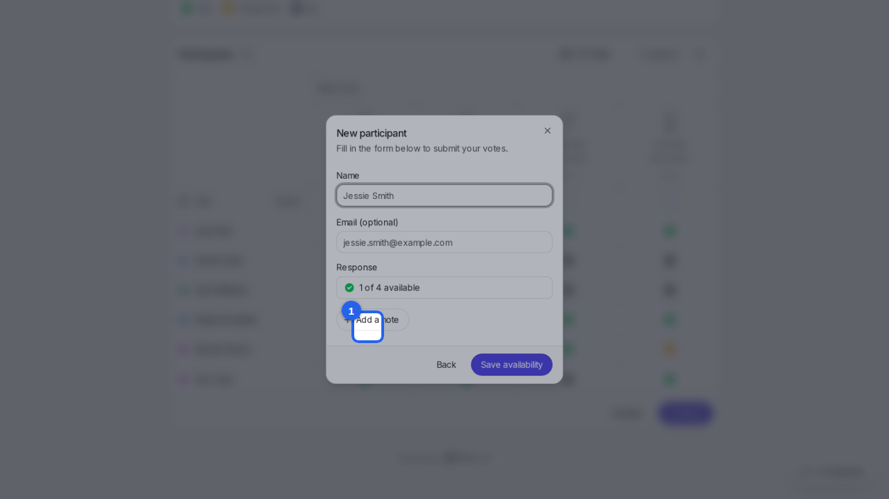
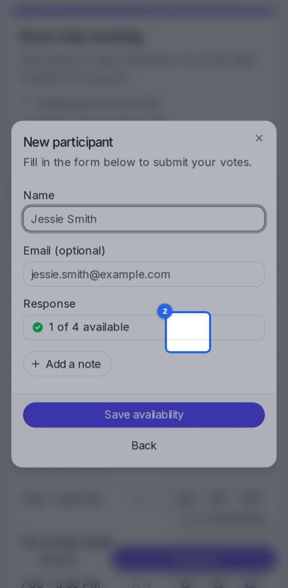
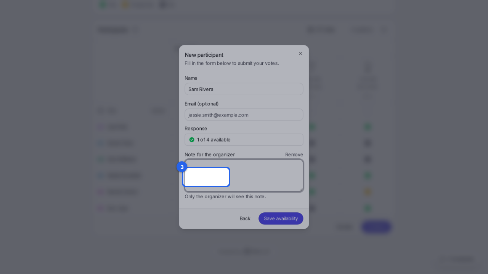
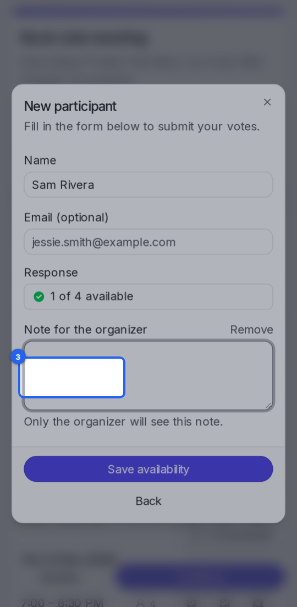
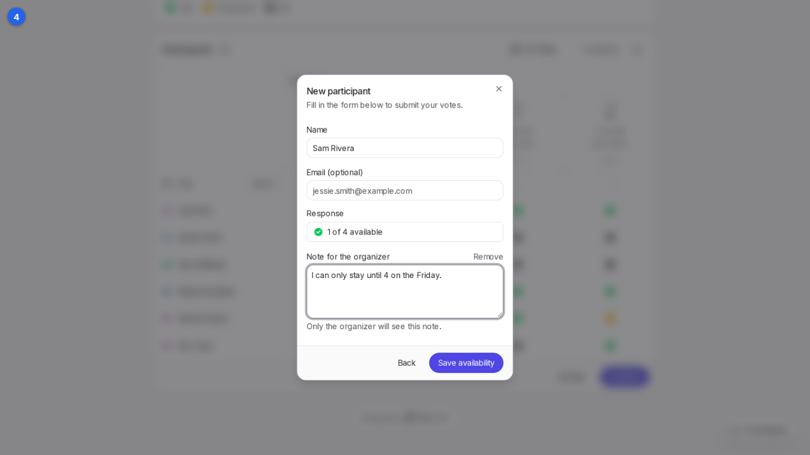
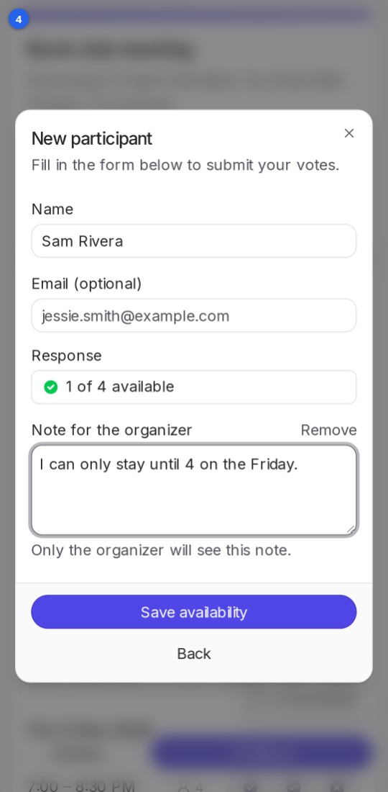
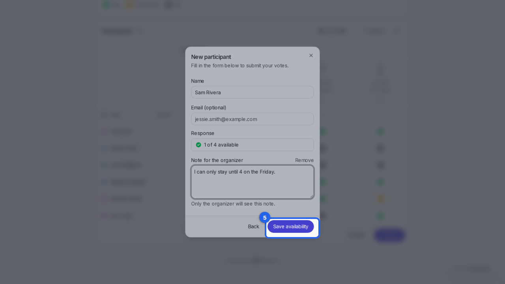
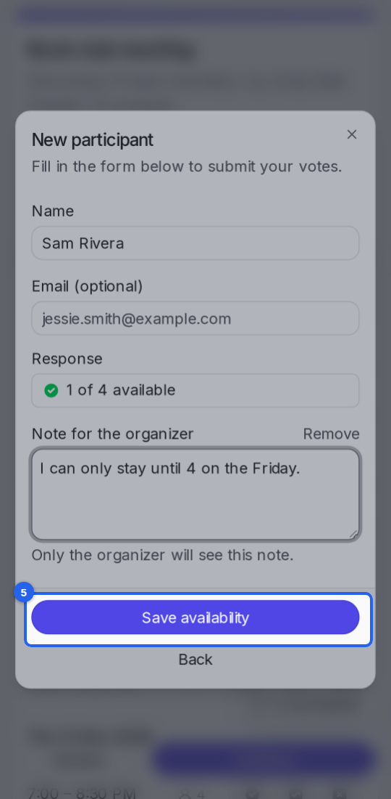

{/* aida:begin header */}
# Add a note to your answer

Explain your answers, like when you can only stay for part of the time. This guide is for people invited to a poll.
{/* aida:end header */}

{/* aida:begin steps-heading */}
## Steps
{/* aida:end steps-heading */}

{/* aida:begin step-mark-dates */}
#### 1. Mark your dates

Mark the dates that work for you in the **You** row, then select **Continue**.

*On a computer only.*

{/* aida:end step-mark-dates */}

{/* aida:begin step-mark-dates-phone */}
#### 2. Mark your dates

Under each date, tap **Yes**, **If need be** or **No**, then select **Continue**.

*On a phone only.*

{/* aida:end step-mark-dates-phone */}

{/* aida:begin step-open-note */}
#### 3. Add a note

Type your name in **Name**, then select **Add a note**.

<DeviceShots devices="desktop,phone">

</DeviceShots>
{/* aida:end step-open-note */}

{/* aida:begin step-write-note */}
#### 4. Write your note

Type your note in **Note for the organizer**. Only the organizer sees it, not the other people on the poll.

<DeviceShots devices="desktop,phone">

</DeviceShots>
{/* aida:end step-write-note */}

{/* aida:begin step-save */}
#### 5. Save your availability

Select **Save availability**. The organizer sees a note icon next to your name and can read it there.

<DeviceShots devices="desktop,phone">

</DeviceShots>
{/* aida:end step-save */}

{/* aida:begin last-checked */}
---

*Steps verified against the real app on 2026-11-08.*
{/* aida:end last-checked */}
