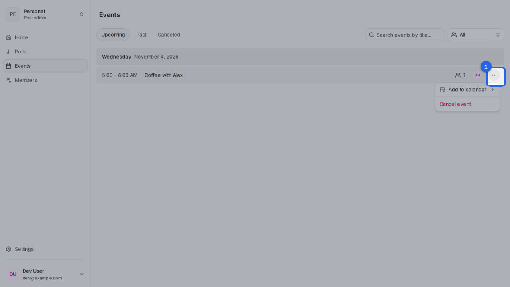
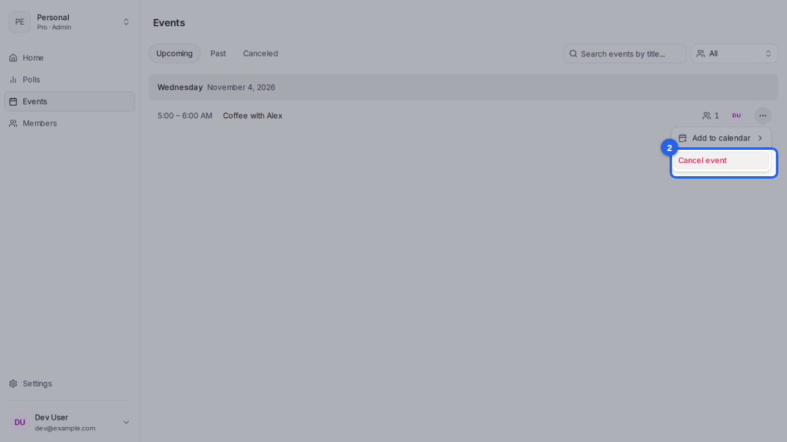
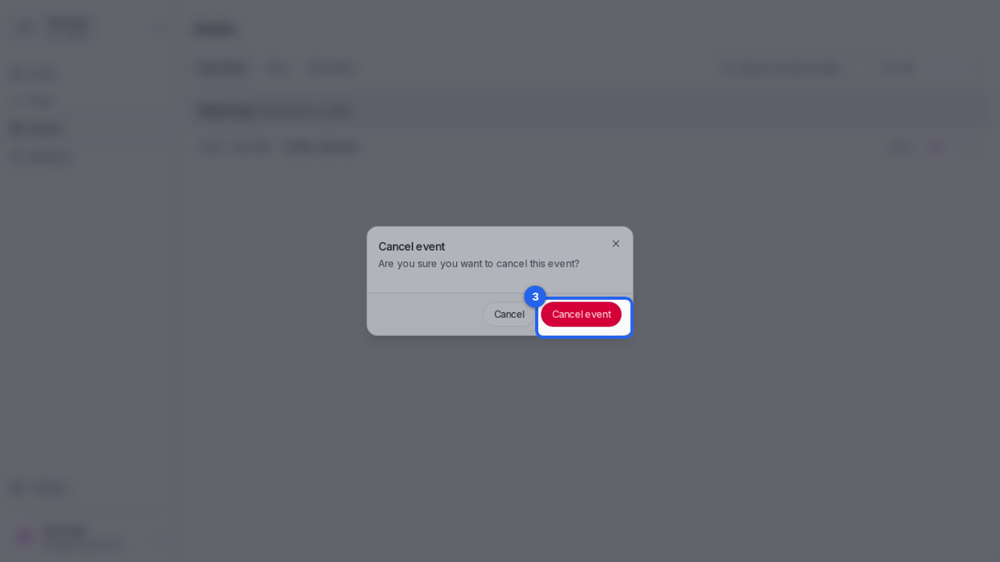

{/* aida:begin header */}
# Cancel an event

Call off an event you've already booked, and let the people invited know. This guide is for organizers.
{/* aida:end header */}

{/* aida:begin before-you-start */}
## Before you start

- Sign in as **an organizer**.
{/* aida:end before-you-start */}

{/* aida:begin steps-heading */}
## Steps
{/* aida:end steps-heading */}

{/* aida:begin step-open-menu */}
#### 1. Open the event's menu

Open **Events** and select the menu (**More options**) on the event you want to call off.

{/* aida:end step-open-menu */}

{/* aida:begin step-choose-cancel */}
#### 2. Choose Cancel event

Select **Cancel event**.

{/* aida:end step-choose-cancel */}

{/* aida:begin step-confirm */}
#### 3. Confirm

Select **Cancel event** to confirm. The event moves to the **Canceled** list, and the people invited get an email saying it's off.

{/* aida:end step-confirm */}

{/* aida:begin last-checked */}
---

*Steps verified against the real app on 2026-10-28.*
{/* aida:end last-checked */}
