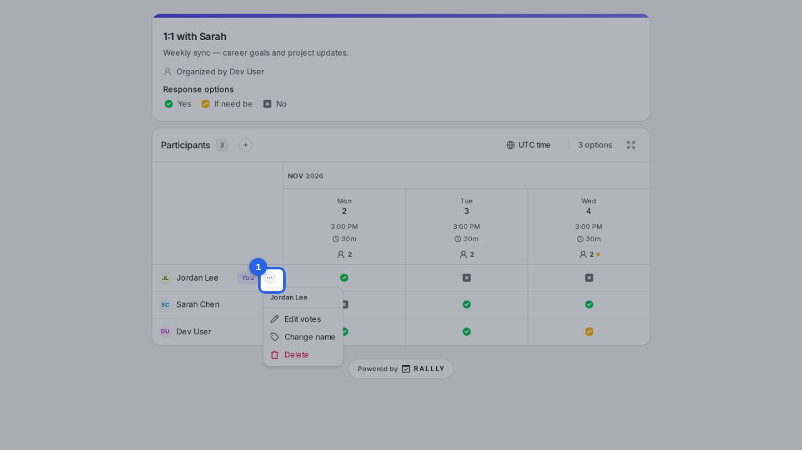
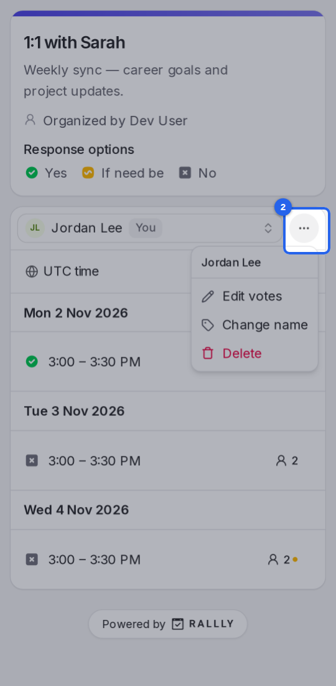
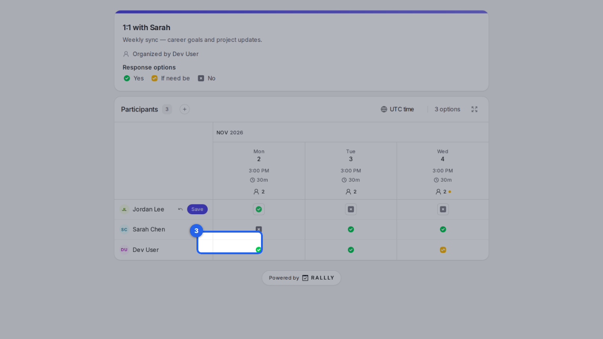
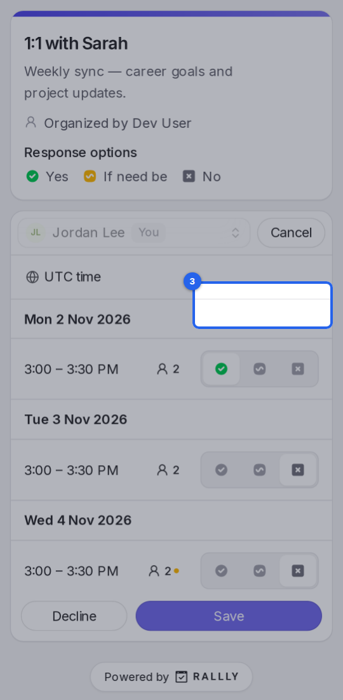
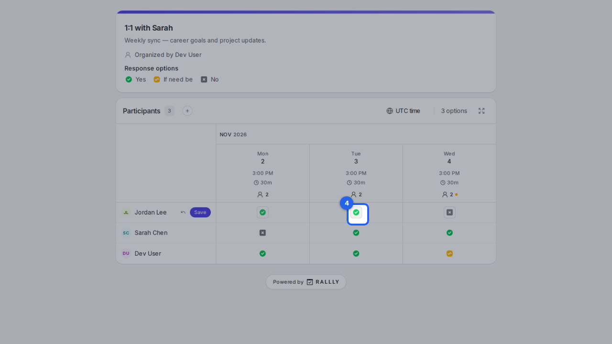
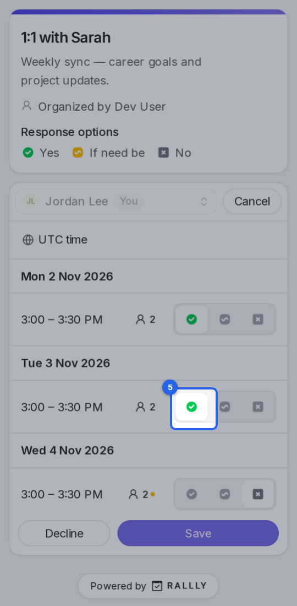
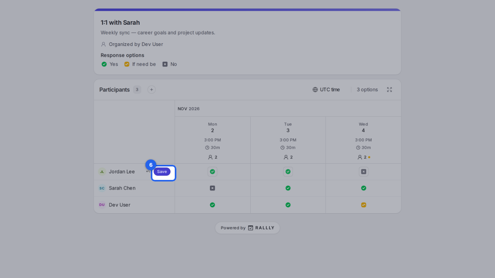
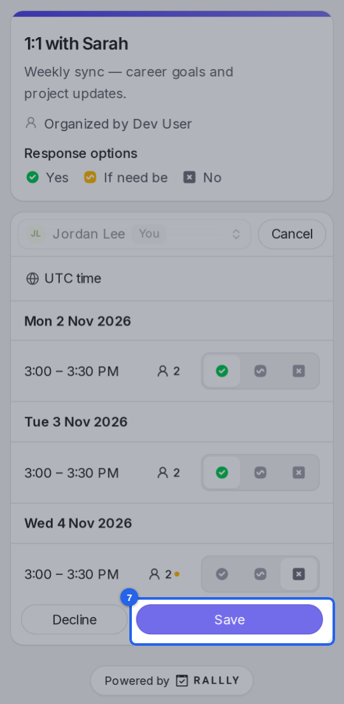

{/* aida:begin header */}
# Change your answers

Update which dates work for you after you've answered a poll. This guide is for people invited to a poll.
{/* aida:end header */}

{/* aida:begin steps-heading */}
## Steps
{/* aida:end steps-heading */}

{/* aida:begin step-open-menu */}
#### 1. Open the menu by your name

Open the poll's link again, in the same browser you answered in. Select the menu next to your name.

*On a computer only.*

{/* aida:end step-open-menu */}

{/* aida:begin step-open-menu-phone */}
#### 2. Open the menu by your name

Open the poll's link again, in the same browser you answered in. Tap the menu next to your name at the top.

*On a phone only.*

{/* aida:end step-open-menu-phone */}

{/* aida:begin step-edit-votes */}
#### 3. Choose Edit votes

Select **Edit votes**. You can also change the name you answered with, or delete your answer.

<DeviceShots devices="desktop,phone">

</DeviceShots>
{/* aida:end step-edit-votes */}

{/* aida:begin step-change-a-date */}
#### 4. Change your answers

Your row opens for editing. Click a date to move it between **Yes**, **If need be** and **No**.

*On a computer only.*

{/* aida:end step-change-a-date */}

{/* aida:begin step-change-a-date-phone */}
#### 5. Change your answers

Your answers open for editing. Under each date, tap **Yes**, **If need be** or **No**.

*On a phone only.*

{/* aida:end step-change-a-date-phone */}

{/* aida:begin step-save */}
#### 6. Save

Select **Save**. Your new answers replace the old ones. On another device, use the link in your confirmation email instead; if you didn't leave an email, ask the organizer to send you your edit link.

*On a computer only.*

{/* aida:end step-save */}

{/* aida:begin step-save-phone */}
#### 7. Save

Select **Save**. Your new answers replace the old ones. On another device, use the link in your confirmation email instead; if you didn't leave an email, ask the organizer to send you your edit link.

*On a phone only.*

{/* aida:end step-save-phone */}

{/* aida:begin last-checked */}
---

*Steps verified against the real app on 2026-11-08.*
{/* aida:end last-checked */}
