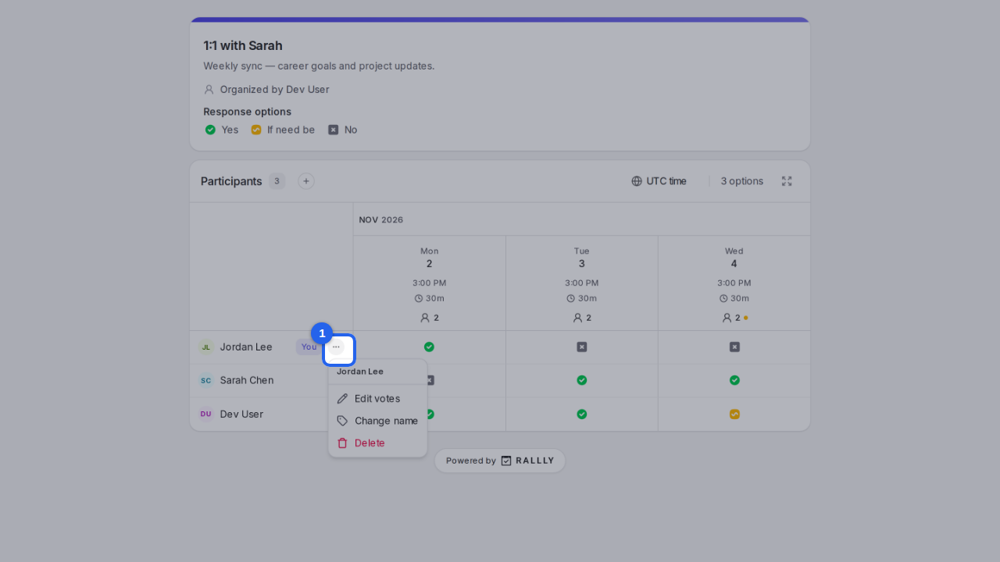
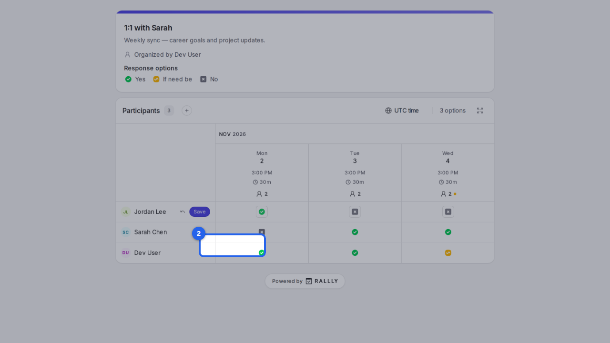
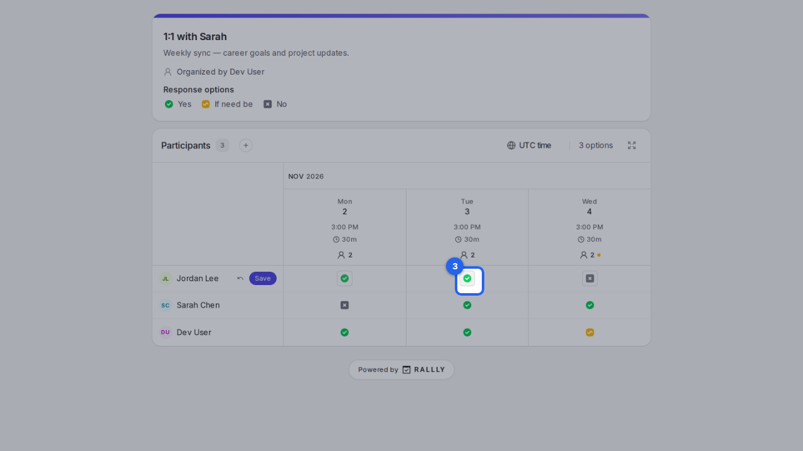
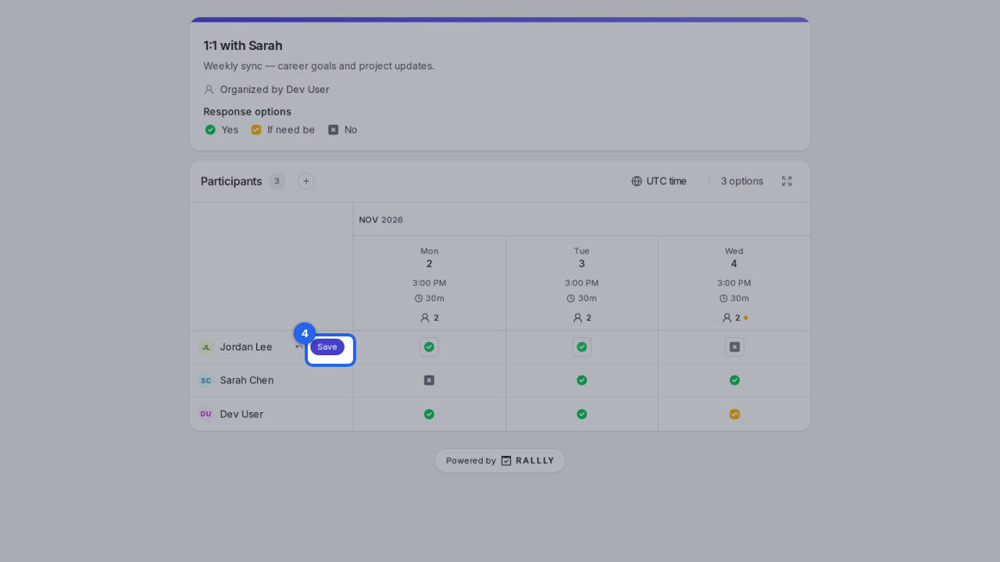

{/* aida:begin header */}
# Change your answers

Update which dates work for you after you've answered a poll. This guide is for people invited to a poll.
{/* aida:end header */}

{/* aida:begin steps-heading */}
## Steps
{/* aida:end steps-heading */}

{/* aida:begin step-open-menu */}
#### 1. Open the menu by your name

Open the poll's link again, in the same browser you answered in. Select the menu next to your name.

{/* aida:end step-open-menu */}

{/* aida:begin step-edit-votes */}
#### 2. Choose Edit votes

Select **Edit votes**. You can also change the name you answered with, or delete your answer.

{/* aida:end step-edit-votes */}

{/* aida:begin step-change-a-date */}
#### 3. Change your answers

Your row opens for editing. Click a date to move it between **Yes**, **If need be** and **No**.

{/* aida:end step-change-a-date */}

{/* aida:begin step-save */}
#### 4. Save

Select **Save**. Your new answers replace the old ones. On another device, use the link in your confirmation email instead; if you didn't leave an email, ask the organizer to send you your edit link.

{/* aida:end step-save */}

{/* aida:begin last-checked */}
---

*Steps verified against the real app on 2026-10-28.*
{/* aida:end last-checked */}
