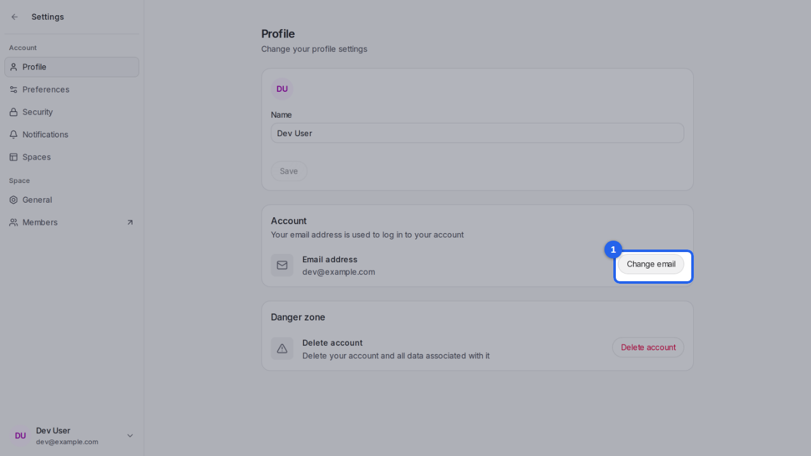
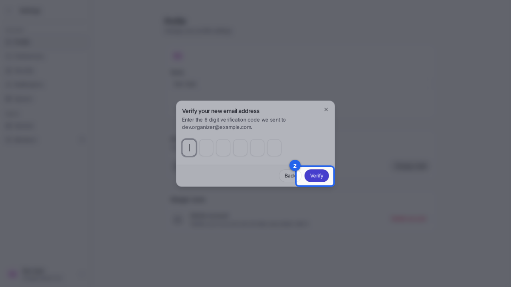
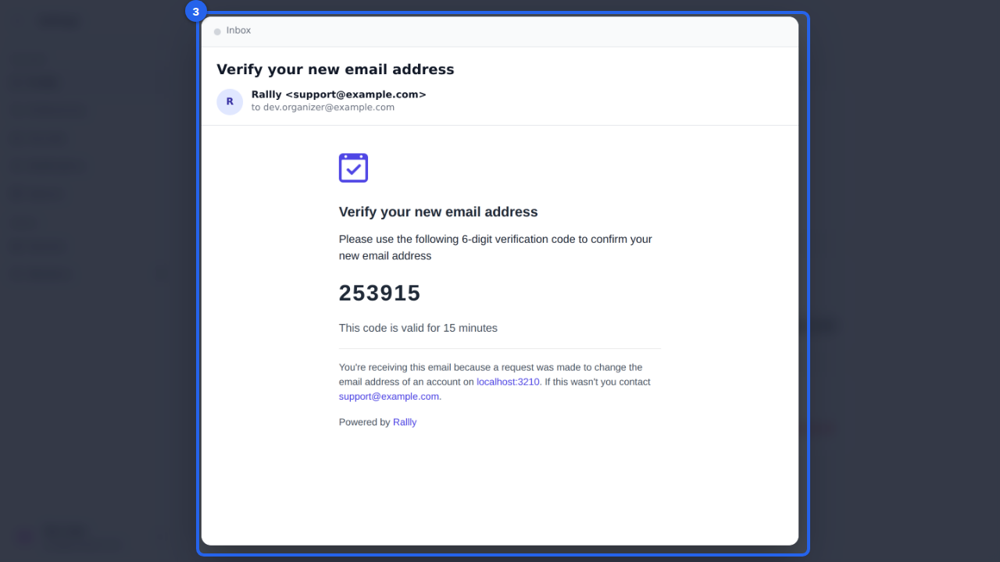
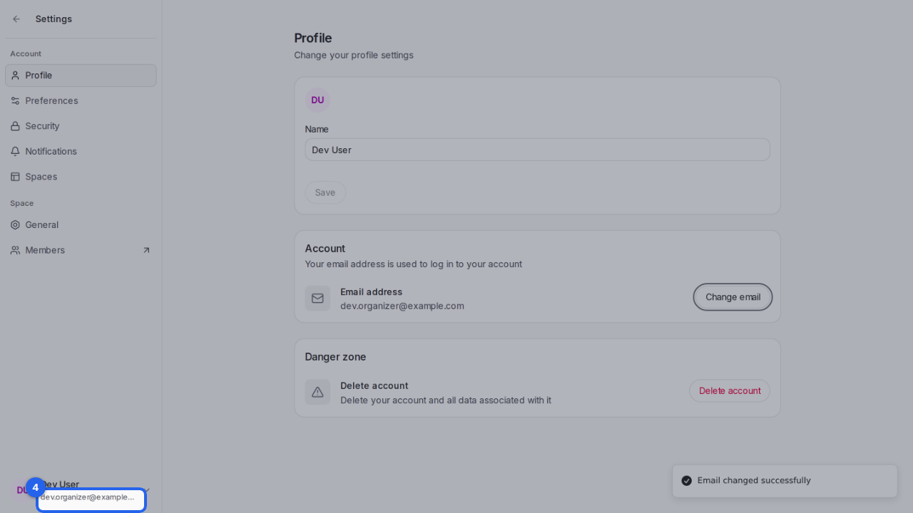

{/* aida:begin header */}
# Change your email address

Move your account to a new email address. Rallly checks it's yours with a code. This guide is for organizers.
{/* aida:end header */}

{/* aida:begin before-you-start */}
## Before you start

- Sign in as **an organizer**.
{/* aida:end before-you-start */}

{/* aida:begin steps-heading */}
## Steps
{/* aida:end steps-heading */}

{/* aida:begin step-open-change */}
#### 1. Open Change email

Open **Settings**, then **Profile**, and select **Change email**.

{/* aida:end step-open-change */}

{/* aida:begin step-new-address */}
#### 2. Enter your new address

Type your new address in **Email** and select **Continue**. Rallly sends a code to the new address, to check it's yours.

{/* aida:end step-new-address */}

{/* aida:begin step-the-code */}
#### 3. Find the code

Open the email Rallly sent to your new address. It holds a six-digit code.

{/* aida:end step-the-code */}

{/* aida:begin step-enter-code */}
#### 4. Enter the code

Back in Rallly, type the code in **Enter your 6-digit code**. Rallly checks it as soon as it's complete; from now on you sign in with the new address.

{/* aida:end step-enter-code */}

{/* aida:begin last-checked */}
---

*Steps verified against the real app on 2026-10-28.*
{/* aida:end last-checked */}
