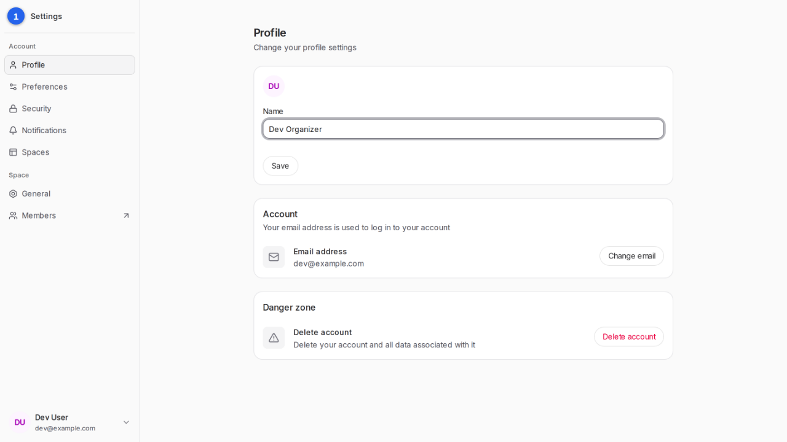
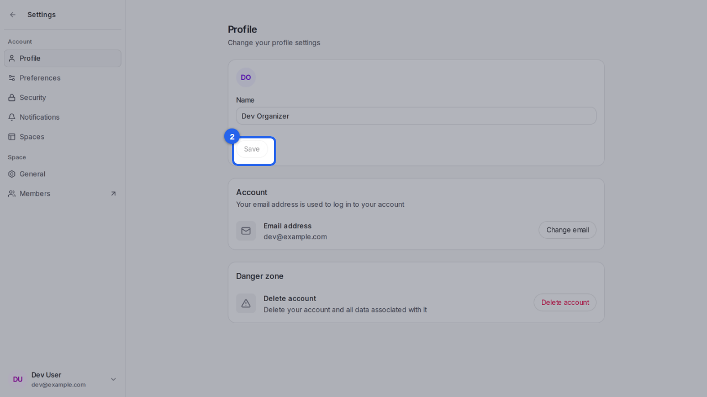

{/* aida:begin header */}
# Change your name

Update the name participants see on your polls. This guide is for organizers.
{/* aida:end header */}

{/* aida:begin before-you-start */}
## Before you start

- Sign in as **an organizer**.
{/* aida:end before-you-start */}

{/* aida:begin steps-heading */}
## Steps
{/* aida:end steps-heading */}

{/* aida:begin step-edit-name */}
#### 1. Change your name

Open **Settings**, then **Profile**. In **Name**, type the name you want participants to see.

{/* aida:end step-edit-name */}

{/* aida:begin step-save */}
#### 2. Save

Select **Save**. Your polls now show the new name as their organizer.

{/* aida:end step-save */}

{/* aida:begin last-checked */}
---

*Steps verified against the real app on 2026-10-28.*
{/* aida:end last-checked */}
