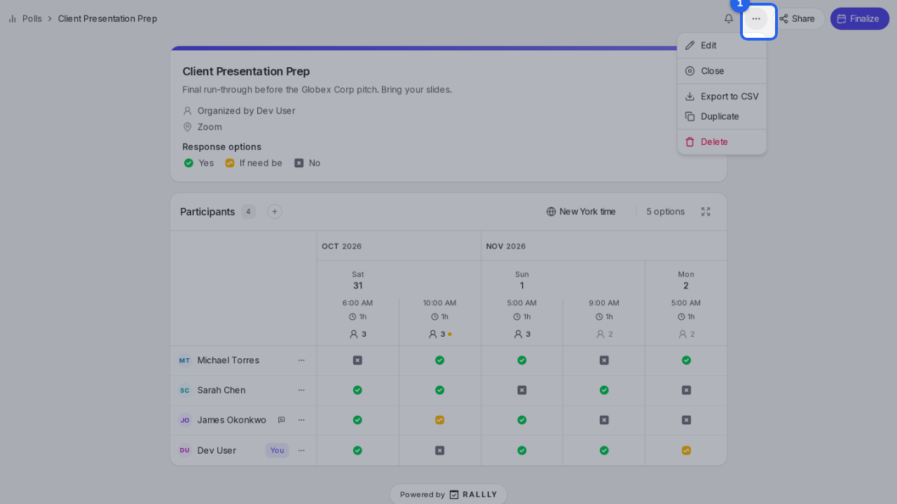
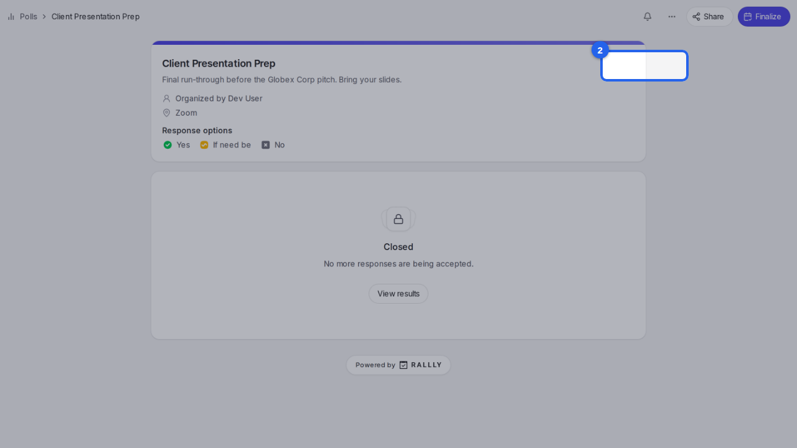
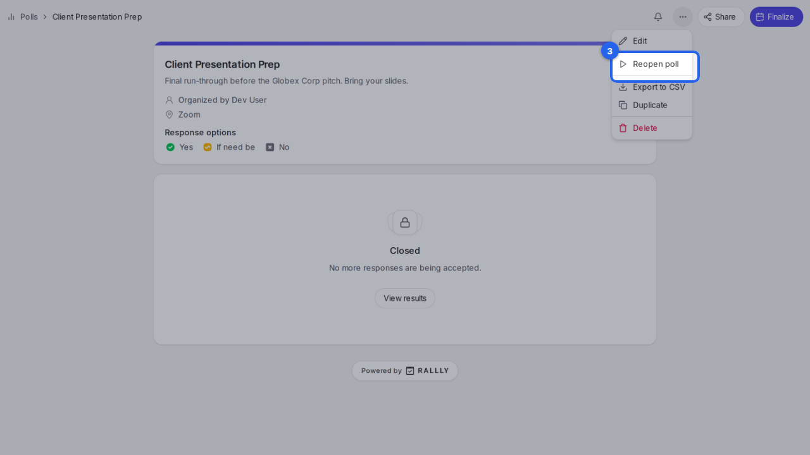

{/* aida:begin header */}
# Close a poll

Stop a poll taking new answers without picking a date, for example when plans have changed. This guide is for organizers.
{/* aida:end header */}

{/* aida:begin before-you-start */}
## Before you start

- Sign in as **an organizer**.
{/* aida:end before-you-start */}

{/* aida:begin steps-heading */}
## Steps
{/* aida:end steps-heading */}

{/* aida:begin step-open-manage */}
#### 1. Open the Manage menu

On your poll's page, select **Manage**.

{/* aida:end step-open-manage */}

{/* aida:begin step-close */}
#### 2. Close the poll

Select **Close**. Everyone's answers are kept, but nobody can add or change one. Closing doesn't pick a date or tell anyone; to do that, finalize the poll instead.

{/* aida:end step-close */}

{/* aida:begin step-closed */}
#### 3. Reopen it later if you need to

The poll now shows as closed. To take answers again, open **Manage** and select **Reopen**.

{/* aida:end step-closed */}

{/* aida:begin last-checked */}
---

*Steps verified against the real app on 2026-10-28.*
{/* aida:end last-checked */}
