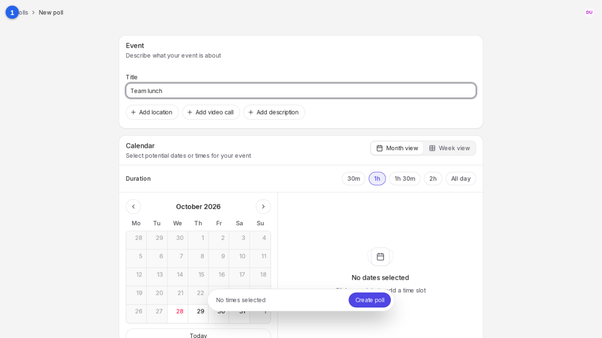
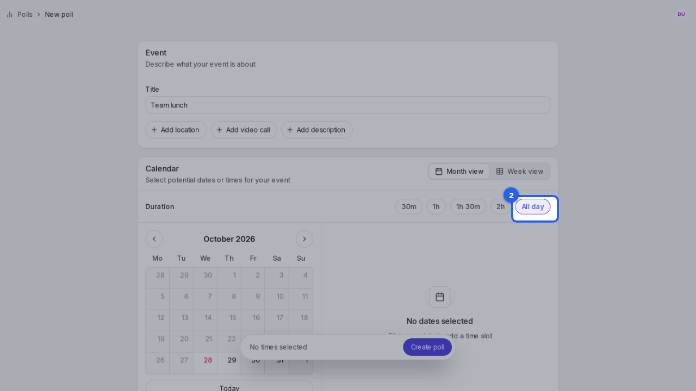
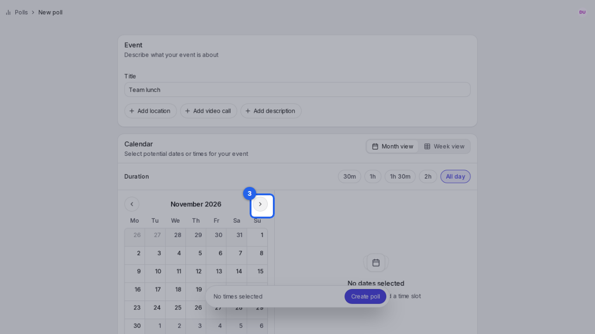
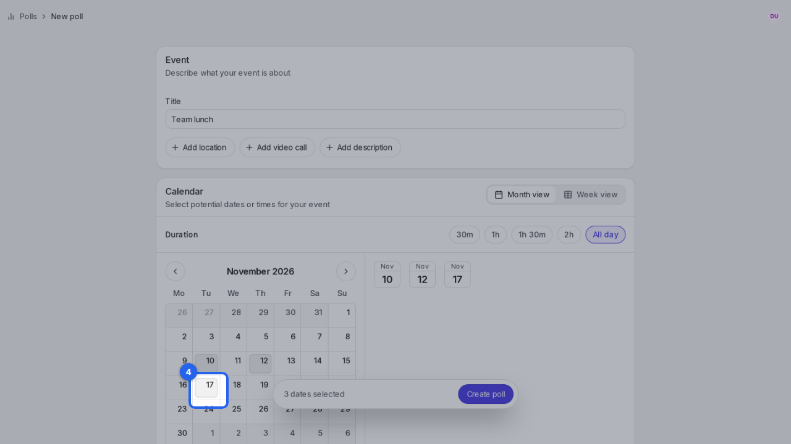
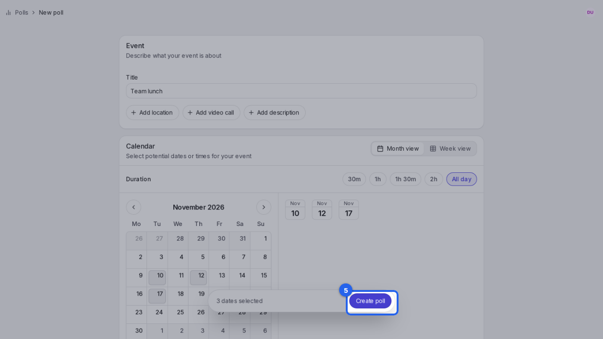
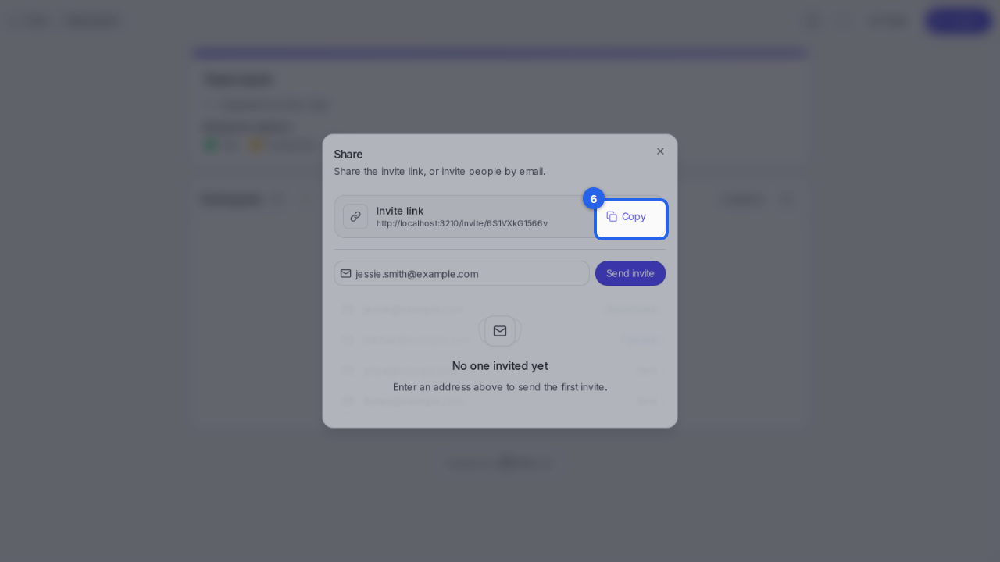

{/* aida:begin header */}
# Create a poll

Suggest a few dates for an event, then create the poll so people can say when they're free. This guide is for organizers.
{/* aida:end header */}

{/* aida:begin before-you-start */}
## Before you start

- Sign in as **an organizer**.
{/* aida:end before-you-start */}

{/* aida:begin steps-heading */}
## Steps
{/* aida:end steps-heading */}

{/* aida:begin chapter-1 */}
### Part 1: Describe the event
{/* aida:end chapter-1 */}

{/* aida:begin step-name-the-event */}
#### 1. Name the event

In **Title**, type a short name for the event, such as "Team lunch".

{/* aida:end step-name-the-event */}

{/* aida:begin chapter-2 */}
### Part 2: Suggest dates
{/* aida:end chapter-2 */}

{/* aida:begin step-choose-all-day */}
#### 2. Choose how long it lasts

Under **Duration**, choose **All day**, or a length such as **1h** to suggest times as well as dates.

{/* aida:end step-choose-all-day */}

{/* aida:begin step-go-to-next-month */}
#### 3. Go to next month

Select the arrow beside the month name to move to next month.

{/* aida:end step-go-to-next-month */}

{/* aida:begin step-pick-dates */}
#### 4. Pick a few dates

Click each date that could work. Each one you pick is added to the list of options.

{/* aida:end step-pick-dates */}

{/* aida:begin chapter-3 */}
### Part 3: Create the poll
{/* aida:end chapter-3 */}

{/* aida:begin step-create */}
#### 5. Create the poll

Select **Create poll**.

{/* aida:end step-create */}

{/* aida:begin step-poll-ready */}
#### 6. Share the invite link

The poll is created and the **Share** window opens. Select **Copy** to copy the invite link, then send it to the people you're inviting. You can also type their email addresses and select **Send invite**.

{/* aida:end step-poll-ready */}

{/* aida:begin last-checked */}
---

*Steps verified against the real app on 2026-10-28.*
{/* aida:end last-checked */}
