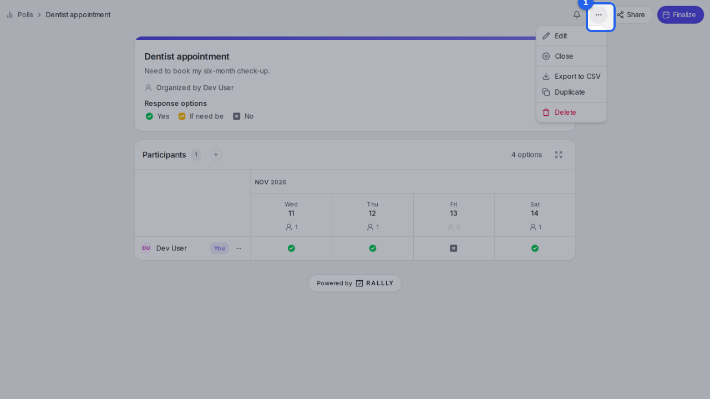
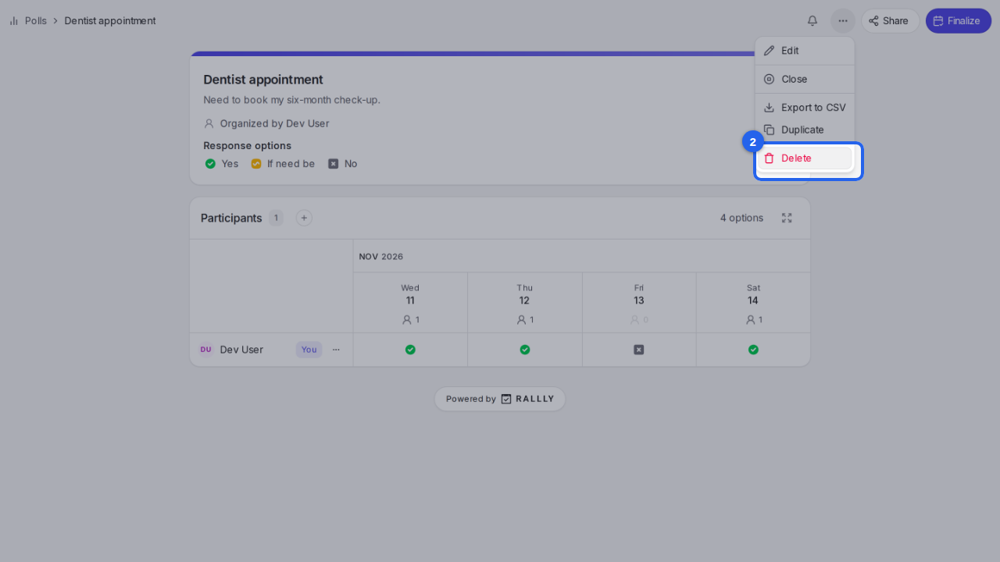
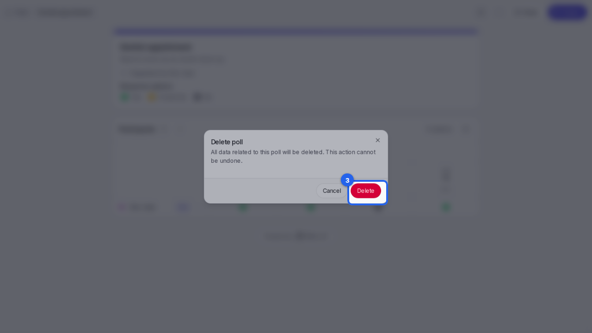

{/* aida:begin header */}
# Delete a poll

Remove a poll you no longer need, with all its dates, answers and comments. This guide is for organizers.
{/* aida:end header */}

{/* aida:begin before-you-start */}
## Before you start

- Sign in as **an organizer**.
{/* aida:end before-you-start */}

{/* aida:begin steps-heading */}
## Steps
{/* aida:end steps-heading */}

{/* aida:begin step-open-manage */}
#### 1. Open the Manage menu

On the poll's page, select **Manage**.

{/* aida:end step-open-manage */}

{/* aida:begin step-choose-delete */}
#### 2. Choose Delete

Select **Delete**.

{/* aida:end step-choose-delete */}

{/* aida:begin step-confirm */}
#### 3. Confirm

Rallly asks you to confirm. Deleting removes the poll, its dates, answers and comments, and **can't be undone**. If you might need the poll again, [close it](./close-a-poll) instead. Select **Delete** to confirm.

{/* aida:end step-confirm */}

{/* aida:begin last-checked */}
---

*Steps verified against the real app on 2026-10-28.*
{/* aida:end last-checked */}
