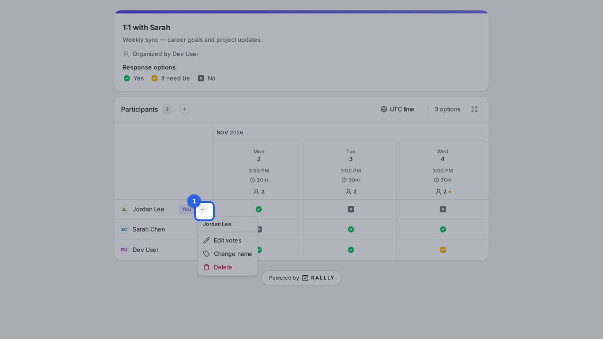
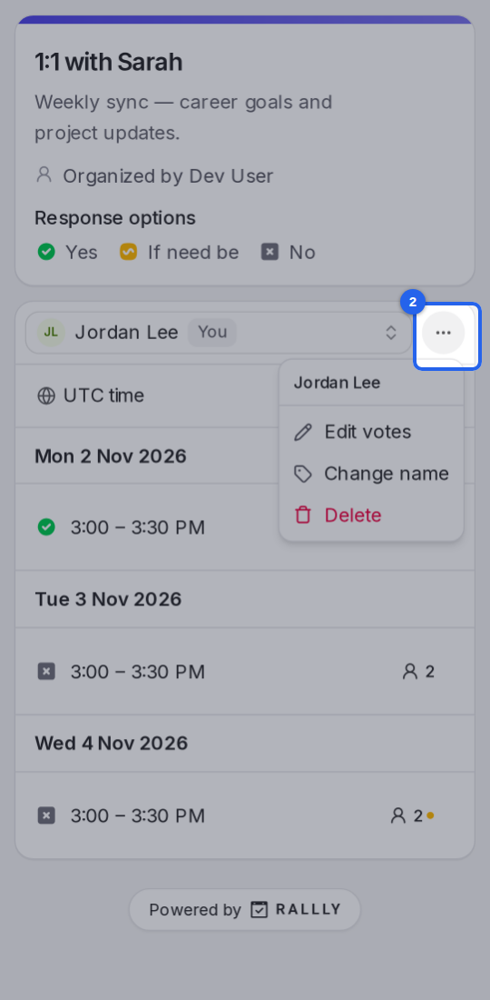
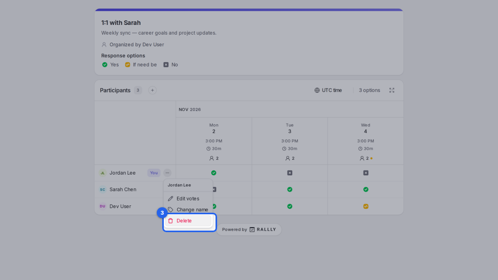
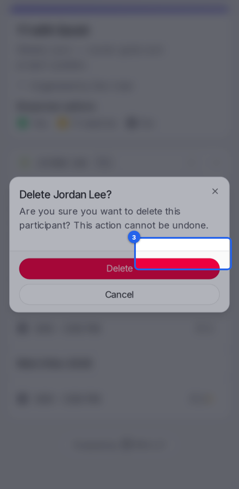
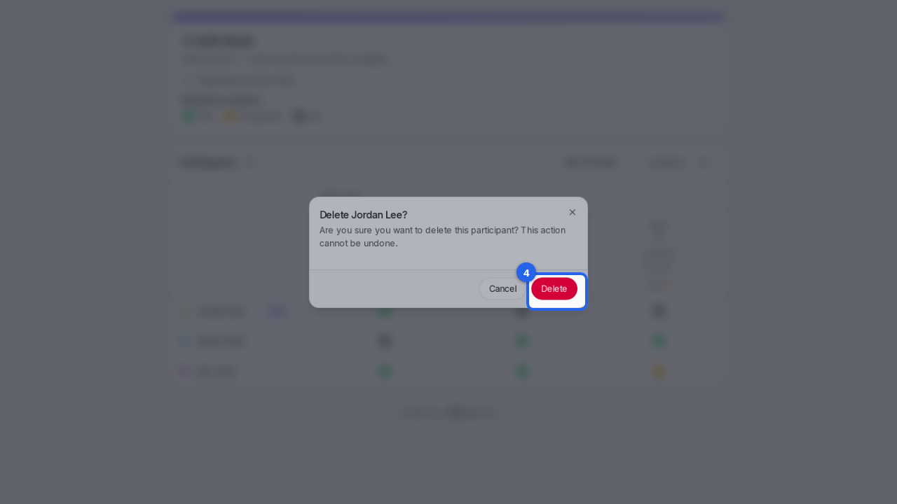
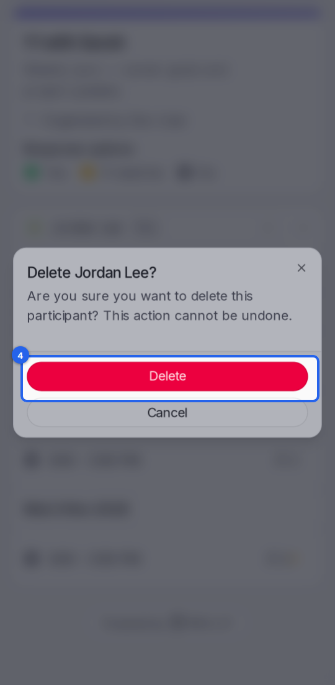

{/* aida:begin header */}
# Remove your answer

Take your name and answers off a poll you've answered. This guide is for people invited to a poll.
{/* aida:end header */}

{/* aida:begin steps-heading */}
## Steps
{/* aida:end steps-heading */}

{/* aida:begin step-open-menu */}
#### 1. Open the menu by your name

Open the poll's link again, in the same browser you answered in. Select the menu next to your name.

*On a computer only.*

{/* aida:end step-open-menu */}

{/* aida:begin step-open-menu-phone */}
#### 2. Open the menu by your name

Open the poll's link again, in the same browser you answered in. Tap the menu next to your name at the top.

*On a phone only.*

{/* aida:end step-open-menu-phone */}

{/* aida:begin step-choose-delete */}
#### 3. Choose Delete

Select **Delete**.

<DeviceShots devices="desktop,phone">

</DeviceShots>
{/* aida:end step-choose-delete */}

{/* aida:begin step-confirm */}
#### 4. Confirm

Select **Delete** to confirm. Your name and answers are removed; this can't be undone, but you can answer again from the same link with **Add participant**.

<DeviceShots devices="desktop,phone">

</DeviceShots>
{/* aida:end step-confirm */}

{/* aida:begin last-checked */}
---

*Steps verified against the real app on 2026-11-08.*
{/* aida:end last-checked */}
