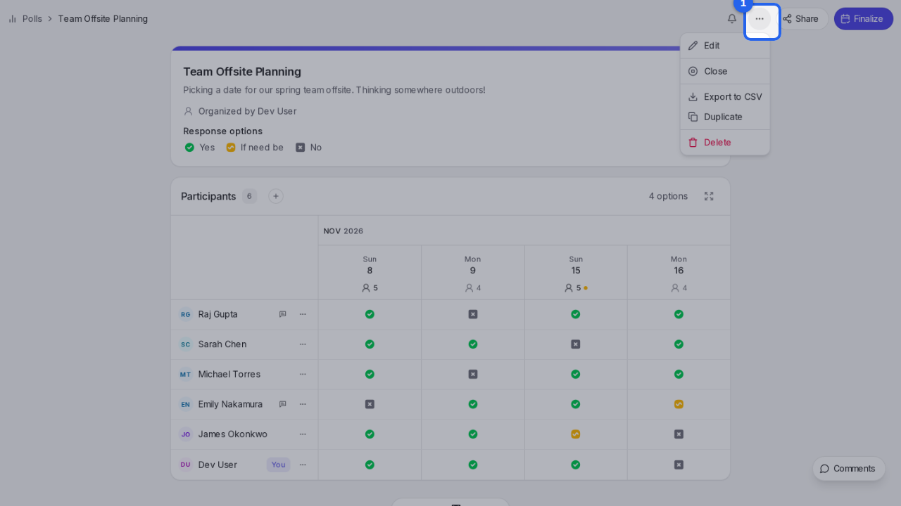
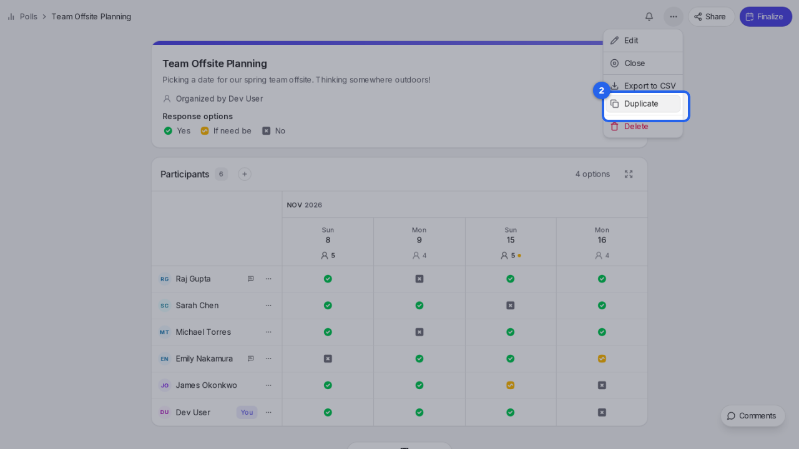
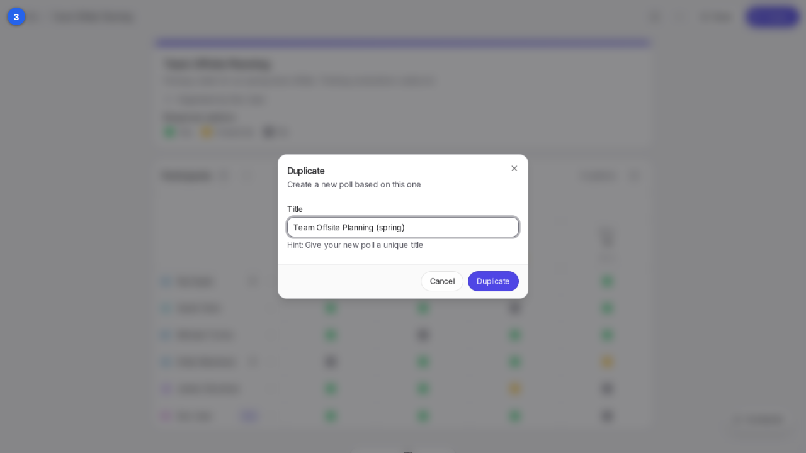

{/* aida:begin header */}
# Duplicate a poll

Start a new poll from an existing one, with the same dates and settings, for a repeat event. This guide is for organizers.
{/* aida:end header */}

{/* aida:begin before-you-start */}
## Before you start

- Sign in as **an organizer**.
{/* aida:end before-you-start */}

{/* aida:begin steps-heading */}
## Steps
{/* aida:end steps-heading */}

{/* aida:begin step-open-manage */}
#### 1. Open the Manage menu

On the poll you want to copy, select **Manage**.

{/* aida:end step-open-manage */}

{/* aida:begin step-choose-duplicate */}
#### 2. Choose Duplicate

Select **Duplicate**.

{/* aida:end step-choose-duplicate */}

{/* aida:begin step-name-it */}
#### 3. Give the new poll its own title

In **Title**, change the name so you can tell the new poll from the old one.

{/* aida:end step-name-it */}

{/* aida:begin step-duplicate */}
#### 4. Create the copy

Select **Duplicate**. The new poll opens with the same dates, details and settings, but none of the answers or comments. Share its link as you would for any new poll.

{/* aida:end step-duplicate */}

{/* aida:begin last-checked */}
---

*Steps verified against the real app on 2026-10-28.*
{/* aida:end last-checked */}
