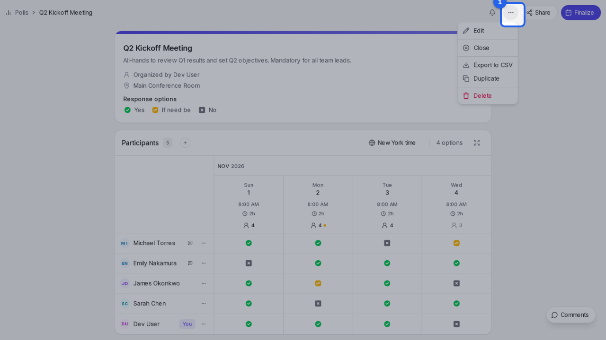
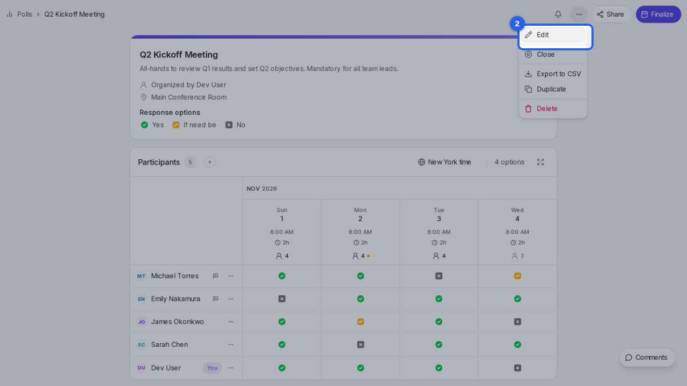
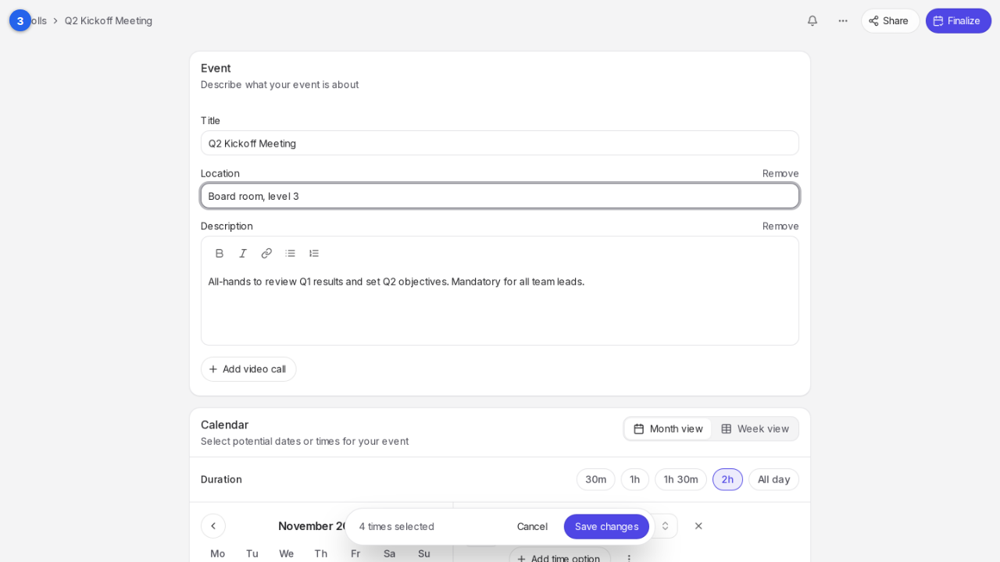
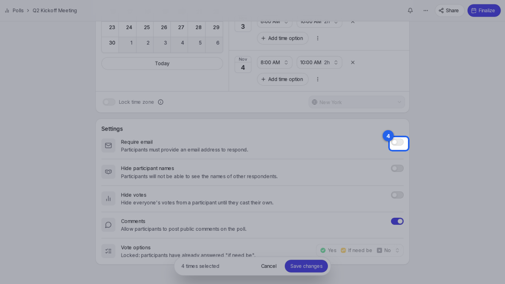
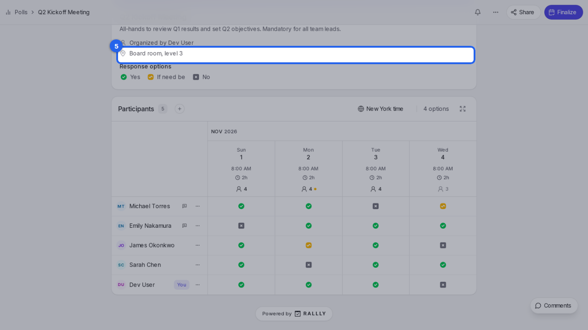

{/* aida:begin header */}
# Edit a poll

Change a poll's details, dates or settings after you've shared it, without losing anyone's answers. This guide is for organizers.
{/* aida:end header */}

{/* aida:begin before-you-start */}
## Before you start

- Sign in as **an organizer**.
{/* aida:end before-you-start */}

{/* aida:begin steps-heading */}
## Steps
{/* aida:end steps-heading */}

{/* aida:begin chapter-1 */}
### Part 1: Open the poll's settings
{/* aida:end chapter-1 */}

{/* aida:begin step-open-manage */}
#### 1. Open the Manage menu

On your poll's page, select **Manage**.

{/* aida:end step-open-manage */}

{/* aida:begin step-choose-edit */}
#### 2. Choose Edit

Select **Edit**. The edit page is laid out like the create page, filled in with the poll's current details.

{/* aida:end step-choose-edit */}

{/* aida:begin chapter-2 */}
### Part 2: Make your changes
{/* aida:end chapter-2 */}

{/* aida:begin step-change-location */}
#### 3. Change the details

Change the title, location or description. Under **Calendar** you can also add or remove dates.

{/* aida:end step-change-location */}

{/* aida:begin step-require-email */}
#### 4. Change a setting

Under **Settings**, turn on **Require email** so every participant leaves an address you can send the final invite to.

{/* aida:end step-require-email */}

{/* aida:begin chapter-3 */}
### Part 3: Save
{/* aida:end chapter-3 */}

{/* aida:begin step-save */}
#### 5. Save your changes

Select **Save changes**. Only the parts you changed are updated, so everyone's answers stay as they were. If you removed a date people voted for, Rallly asks you to confirm first.

{/* aida:end step-save */}

{/* aida:begin last-checked */}
---

*Steps verified against the real app on 2026-10-28.*
{/* aida:end last-checked */}
