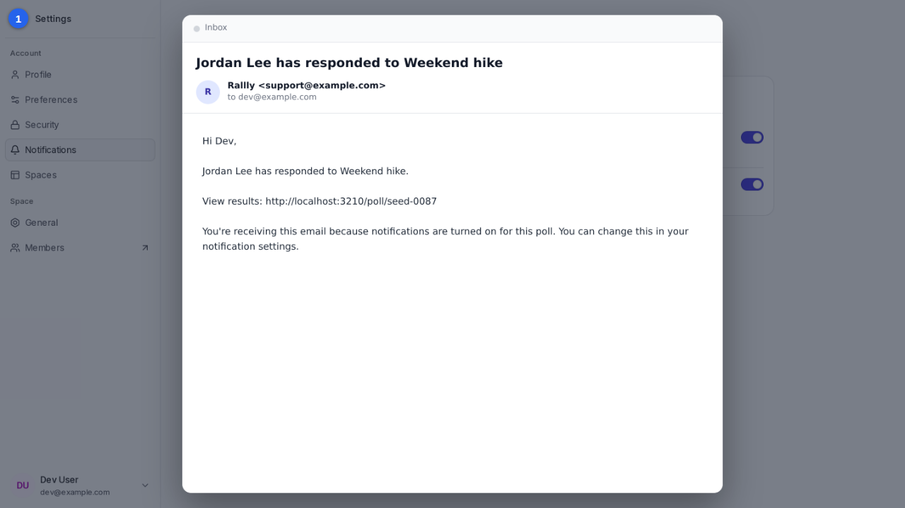
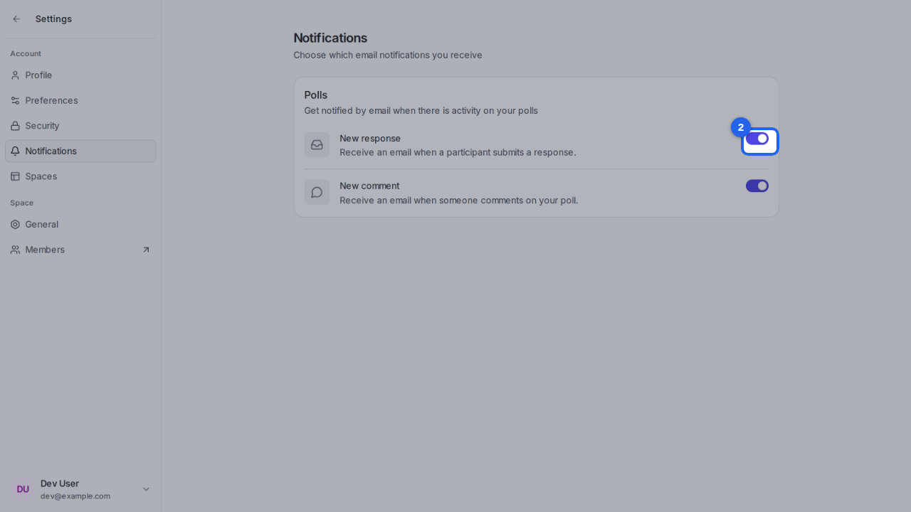

{/* aida:begin header */}
# Choose your email notifications

Decide whether Rallly emails you when someone answers or comments on your polls. This guide is for organizers.
{/* aida:end header */}

{/* aida:begin before-you-start */}
## Before you start

- Sign in as **an organizer**.
{/* aida:end before-you-start */}

{/* aida:begin steps-heading */}
## Steps
{/* aida:end steps-heading */}

{/* aida:begin step-what-you-get */}
#### 1. See what you'll be told about

Open **Settings**, then **Notifications**. With **New response** on, Rallly emails you each time someone answers one of your polls.

{/* aida:end step-what-you-get */}

{/* aida:begin step-turn-off-responses */}
#### 2. Turn notifications off or on

To stop these emails, turn off **New response**. **New comment** does the same for comments. Changes are saved straight away.

{/* aida:end step-turn-off-responses */}

{/* aida:begin last-checked */}
---

*Steps verified against the real app on 2026-10-28.*
{/* aida:end last-checked */}
