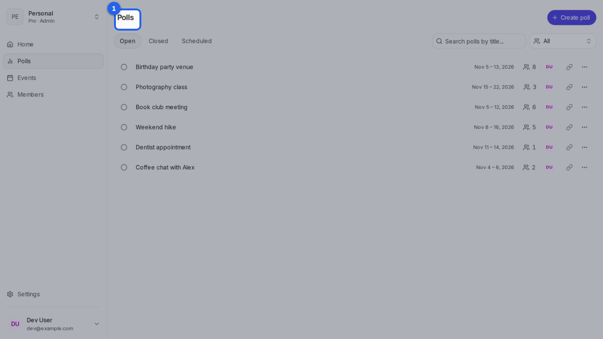
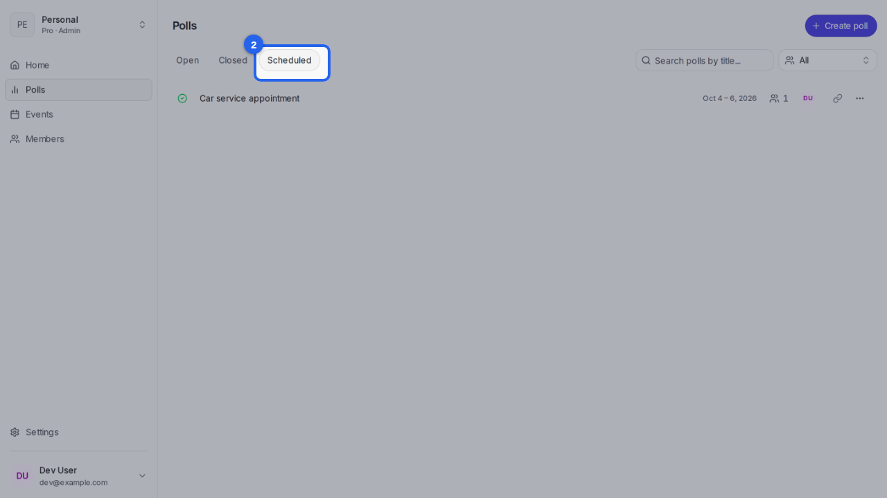
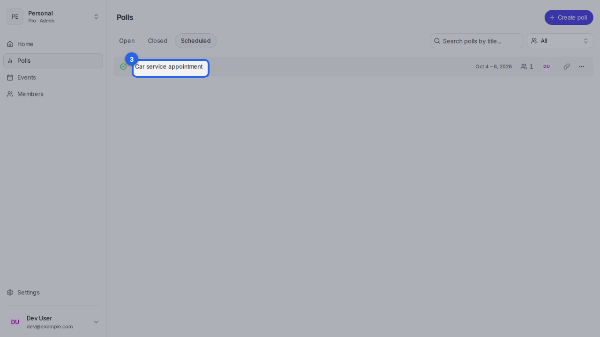

{/* aida:begin header */}
# Find your polls

See all your polls in one list, and filter it to the ones still open, closed or scheduled. This guide is for organizers.
{/* aida:end header */}

{/* aida:begin before-you-start */}
## Before you start

- Sign in as **an organizer**.
{/* aida:end before-you-start */}

{/* aida:begin steps-heading */}
## Steps
{/* aida:end steps-heading */}

{/* aida:begin step-polls-list */}
#### 1. Open Polls

Open **Polls** from the menu. Every poll you've created is listed, newest first, with how many people have answered.

{/* aida:end step-polls-list */}

{/* aida:begin step-filter-closed */}
#### 2. Filter by status

Select **Open**, **Closed** or **Scheduled** to show only those polls. Open polls are still taking answers; scheduled ones have a final date.

{/* aida:end step-filter-closed */}

{/* aida:begin step-open-one */}
#### 3. Open a poll

Select a poll's title to open it.

{/* aida:end step-open-one */}

{/* aida:begin last-checked */}
---

*Steps verified against the real app on 2026-10-28.*
{/* aida:end last-checked */}
