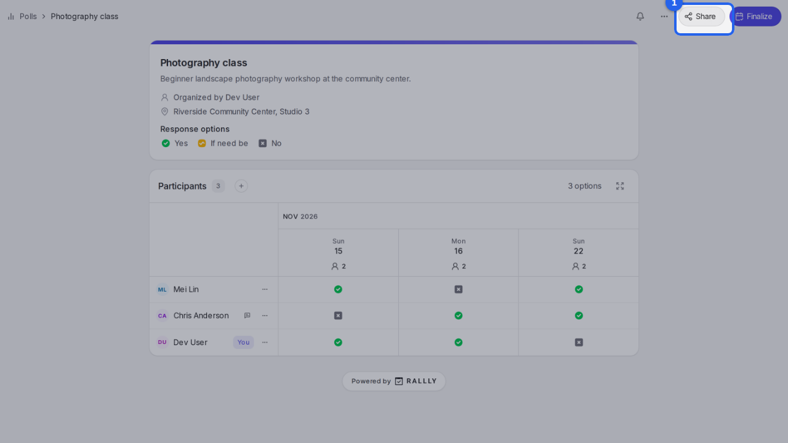
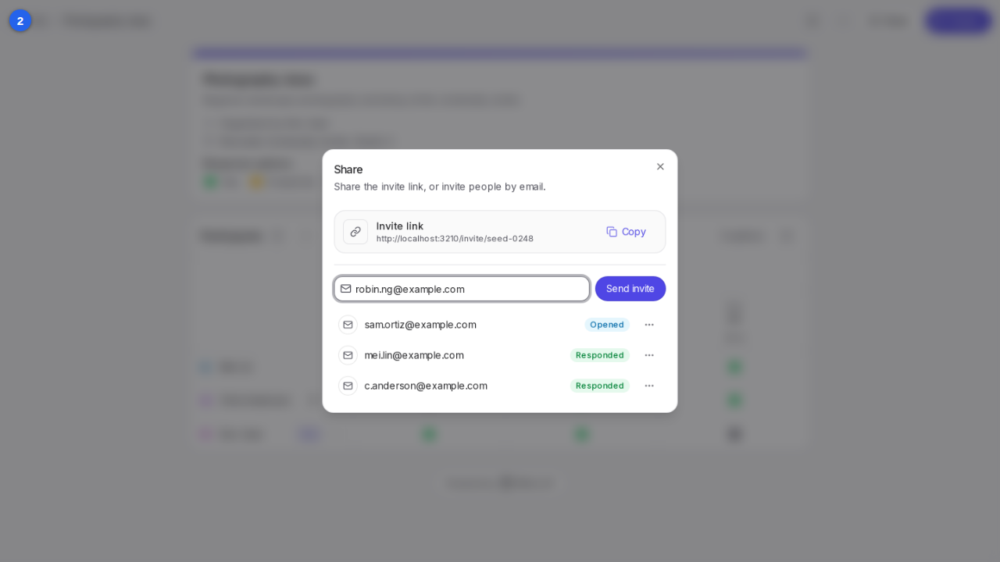
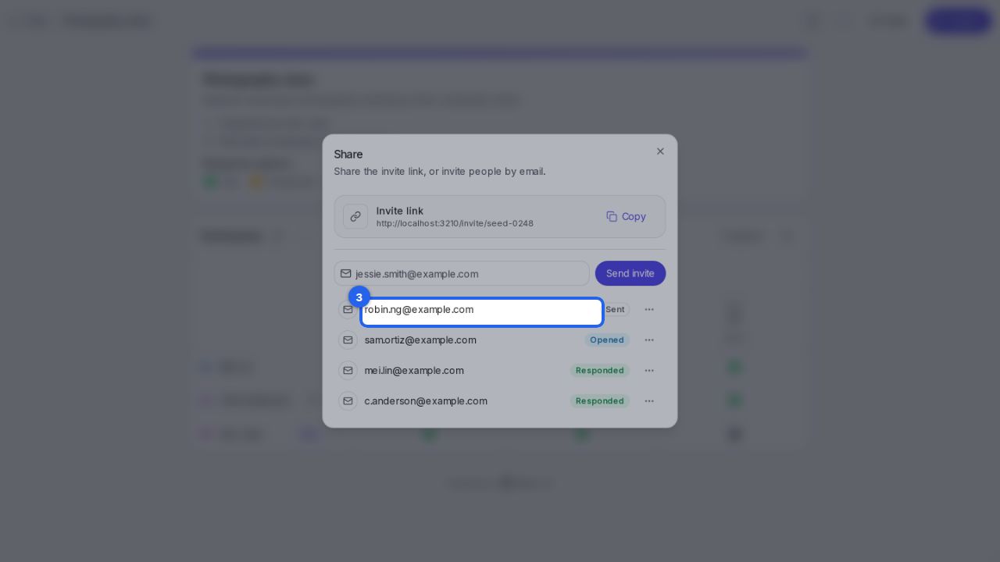
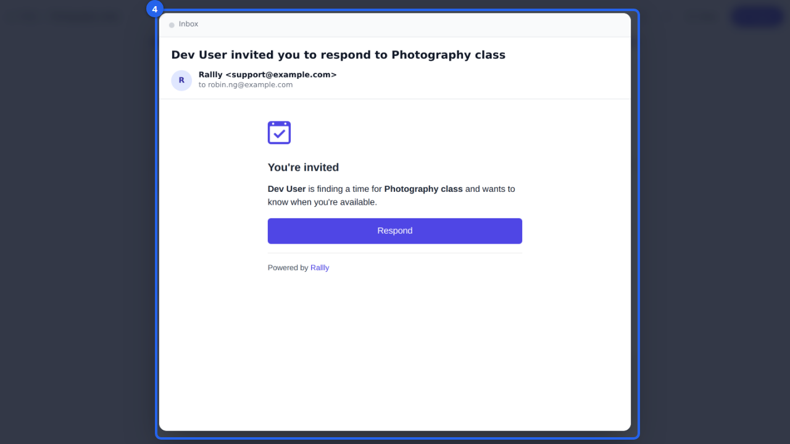

{/* aida:begin header */}
# Invite people by email

Send someone an email invitation to your poll, so they can answer straight from their inbox. This guide is for organizers.
{/* aida:end header */}

{/* aida:begin before-you-start */}
## Before you start

- Sign in as **an organizer**.
{/* aida:end before-you-start */}

{/* aida:begin steps-heading */}
## Steps
{/* aida:end steps-heading */}

{/* aida:begin step-open-share */}
#### 1. Open Share

On your poll's page, select **Share**.

{/* aida:end step-open-share */}

{/* aida:begin step-enter-email */}
#### 2. Enter their email address

In **Email address**, type the address of the person you're inviting.

{/* aida:end step-enter-email */}

{/* aida:begin step-send */}
#### 3. Send the invite

Select **Send invite**. They're added to the list below, where you can see whether they've opened the invite and answered.

{/* aida:end step-send */}

{/* aida:begin step-their-email */}
#### 4. What they receive

They get an email inviting them to your poll, with a button that opens it so they can answer.

{/* aida:end step-their-email */}

{/* aida:begin last-checked */}
---

*Steps verified against the real app on 2026-10-28.*
{/* aida:end last-checked */}
