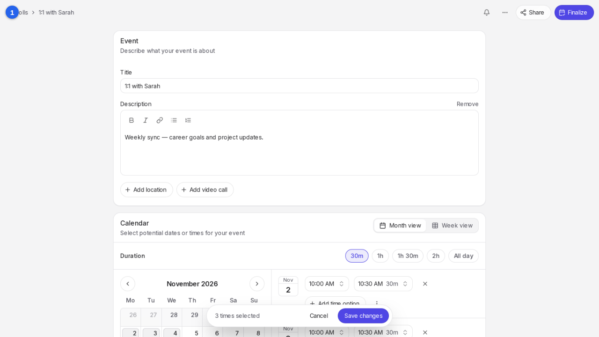
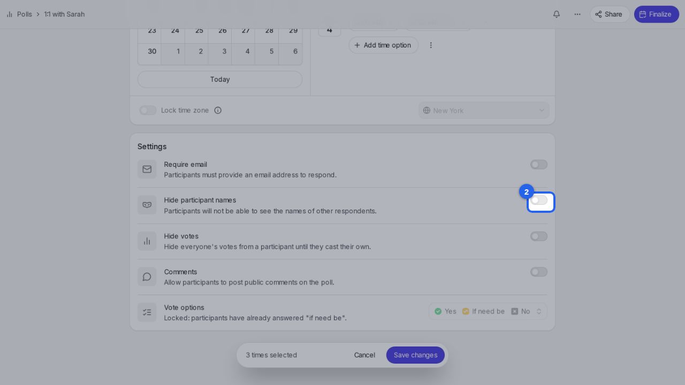
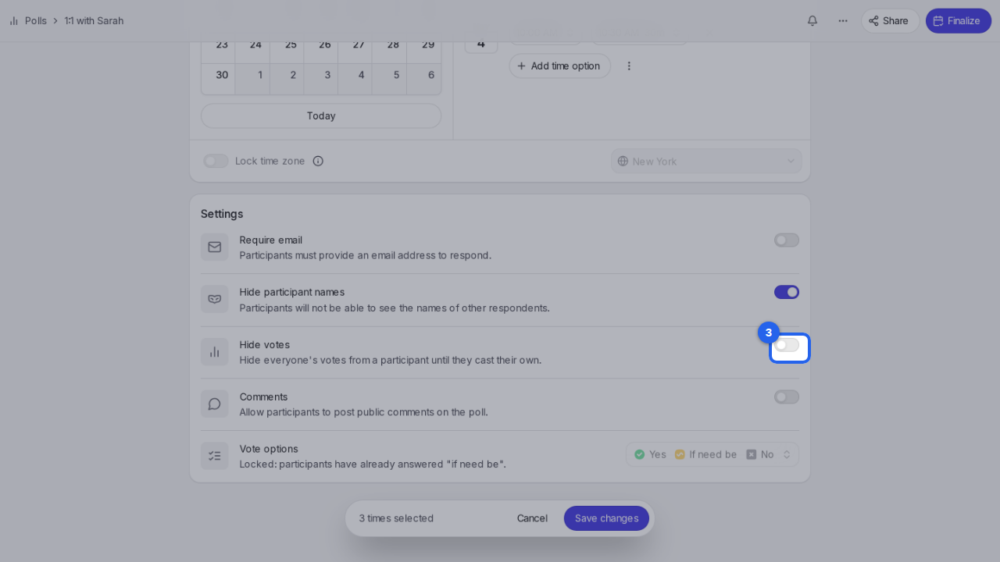
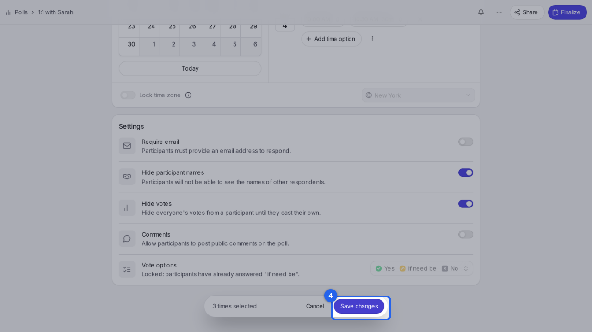

{/* aida:begin header */}
# Keep people's answers private

Hide who answered and how, so each person only sees their own answers. This guide is for organizers.
{/* aida:end header */}

{/* aida:begin before-you-start */}
## Before you start

- Sign in as **an organizer**.
{/* aida:end before-you-start */}

{/* aida:begin steps-heading */}
## Steps
{/* aida:end steps-heading */}

{/* aida:begin step-find-settings */}
#### 1. Go to Settings

On your poll, open **Manage** and select **Edit**, then scroll down to **Settings**.

{/* aida:end step-find-settings */}

{/* aida:begin step-hide-names */}
#### 2. Hide participant names

Turn on **Hide participant names**. Each participant sees only their own row; you still see everyone.

{/* aida:end step-hide-names */}

{/* aida:begin step-hide-votes */}
#### 3. Hide votes until people answer

To stop the results swaying anyone, turn on **Hide votes**. People see the totals only after they've answered.

{/* aida:end step-hide-votes */}

{/* aida:begin step-save */}
#### 4. Save

Select **Save changes**.

{/* aida:end step-save */}

{/* aida:begin last-checked */}
---

*Steps verified against the real app on 2026-10-28.*
{/* aida:end last-checked */}
