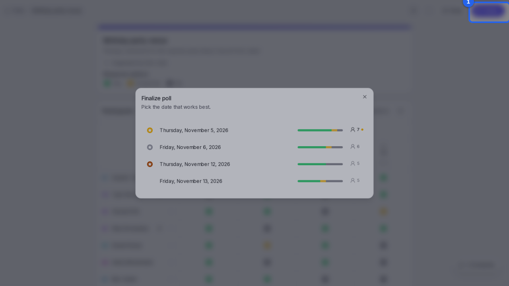
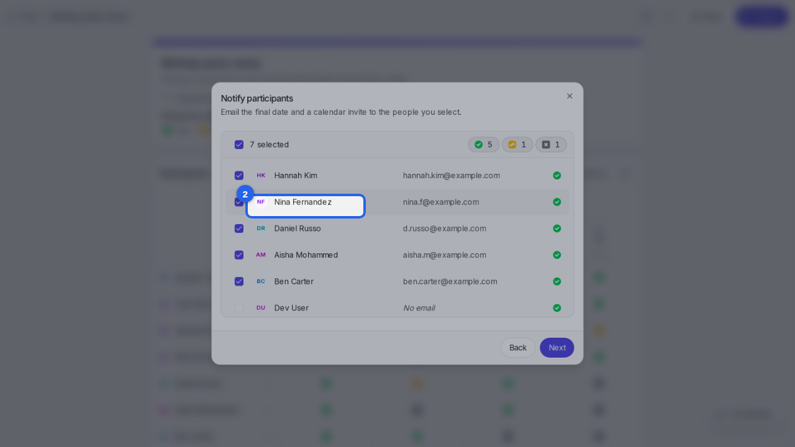
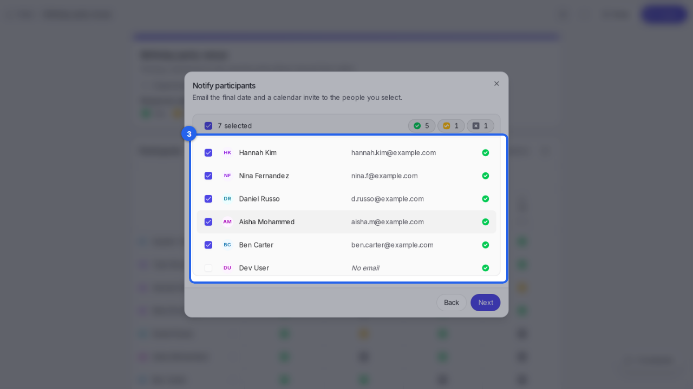
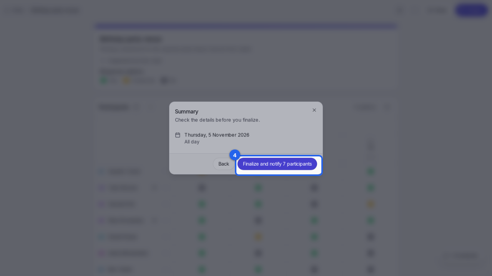

{/* aida:begin header */}
# Pick the final date

Once people have answered, choose the date that works best and let everyone know. This guide is for organizers.
{/* aida:end header */}

{/* aida:begin before-you-start */}
## Before you start

- Sign in as **an organizer**.
{/* aida:end before-you-start */}

{/* aida:begin steps-heading */}
## Steps
{/* aida:end steps-heading */}

{/* aida:begin chapter-1 */}
### Part 1: Choose the date
{/* aida:end chapter-1 */}

{/* aida:begin step-open-finalize */}
#### 1. Open Finalize

Open the poll and select **Finalize**.

{/* aida:end step-open-finalize */}

{/* aida:begin step-choose-top-date */}
#### 2. Choose the date

Dates are listed by how many people can make them, best first. Select the date you want.

{/* aida:end step-choose-top-date */}

{/* aida:begin chapter-2 */}
### Part 2: Let people know
{/* aida:end chapter-2 */}

{/* aida:begin step-choose-who-to-tell */}
#### 3. Choose who to tell

Everyone who answered is ticked. Untick anyone who shouldn't get the email and calendar invite, then select **Next**.

{/* aida:end step-choose-who-to-tell */}

{/* aida:begin step-finalize */}
#### 4. Check and finalize

Check the date in the summary, then select **Finalize and notify**. Rallly emails the people you chose and marks the poll as scheduled.

{/* aida:end step-finalize */}

{/* aida:begin last-checked */}
---

*Steps verified against the real app on 2026-10-28.*
{/* aida:end last-checked */}
