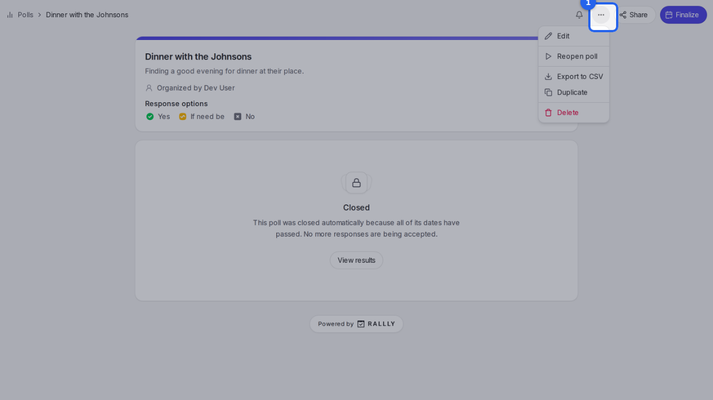
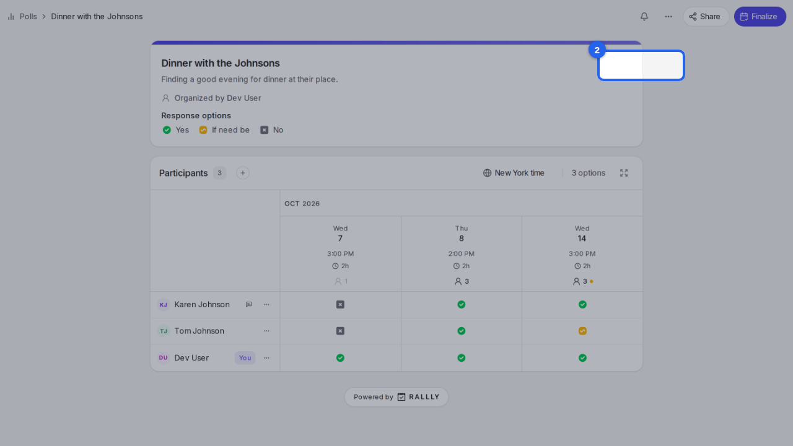

{/* aida:begin header */}
# Reopen a closed poll

Start taking answers again on a poll you closed. This guide is for organizers.
{/* aida:end header */}

{/* aida:begin before-you-start */}
## Before you start

- Sign in as **an organizer**.
{/* aida:end before-you-start */}

{/* aida:begin steps-heading */}
## Steps
{/* aida:end steps-heading */}

{/* aida:begin step-open-manage */}
#### 1. Open the Manage menu

On the closed poll's page, select **Manage**.

{/* aida:end step-open-manage */}

{/* aida:begin step-reopen */}
#### 2. Choose Reopen

Select **Reopen**. The poll takes answers again, and everything people said before is still there.

{/* aida:end step-reopen */}

{/* aida:begin last-checked */}
---

*Steps verified against the real app on 2026-10-28.*
{/* aida:end last-checked */}
