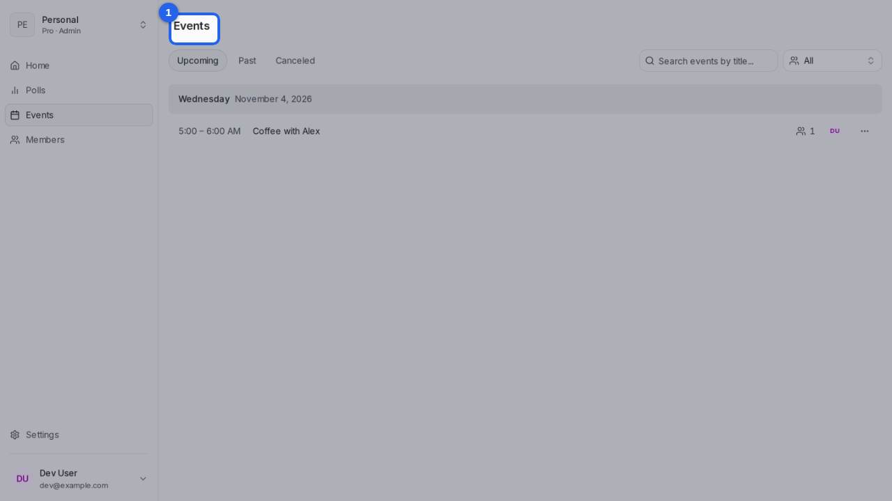
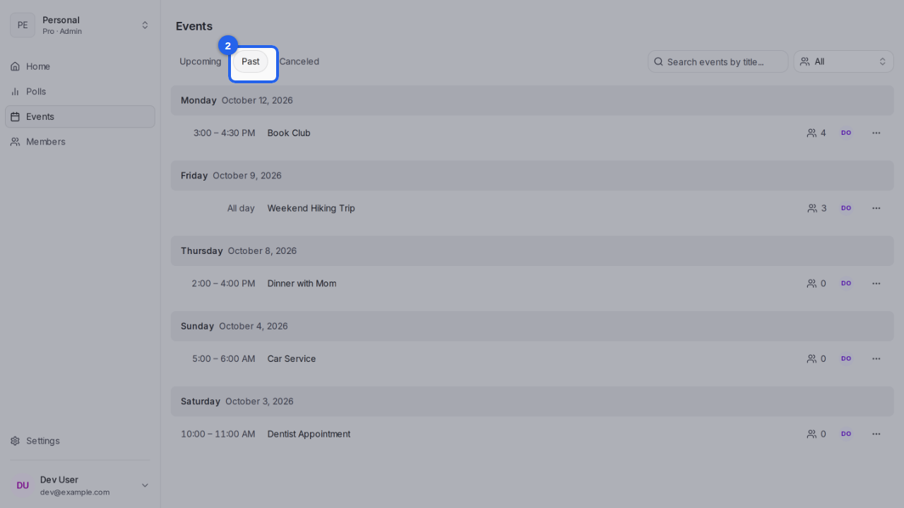

{/* aida:begin header */}
# See your upcoming events

Every date you've finalized, in one list, with past and canceled events a click away. This guide is for organizers.
{/* aida:end header */}

{/* aida:begin before-you-start */}
## Before you start

- Sign in as **an organizer**.
{/* aida:end before-you-start */}

{/* aida:begin steps-heading */}
## Steps
{/* aida:end steps-heading */}

{/* aida:begin step-upcoming */}
#### 1. Open Events

Open **Events** from the menu. Every date you've finalized is listed here, soonest first.

{/* aida:end step-upcoming */}

{/* aida:begin step-past */}
#### 2. See past events

Select **Past** or **Canceled** to see events that have happened or were called off.

{/* aida:end step-past */}

{/* aida:begin last-checked */}
---

*Steps verified against the real app on 2026-10-28.*
{/* aida:end last-checked */}
