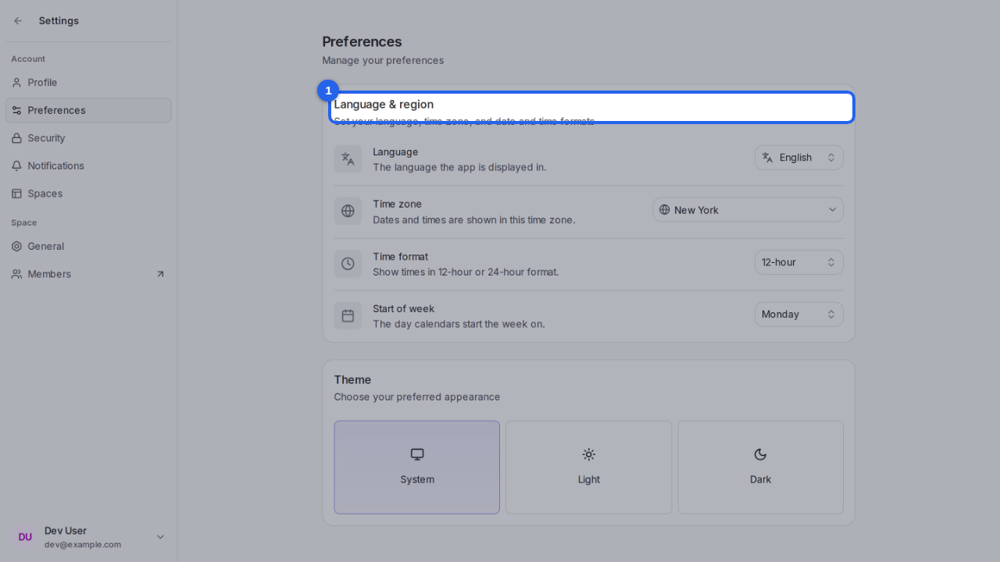
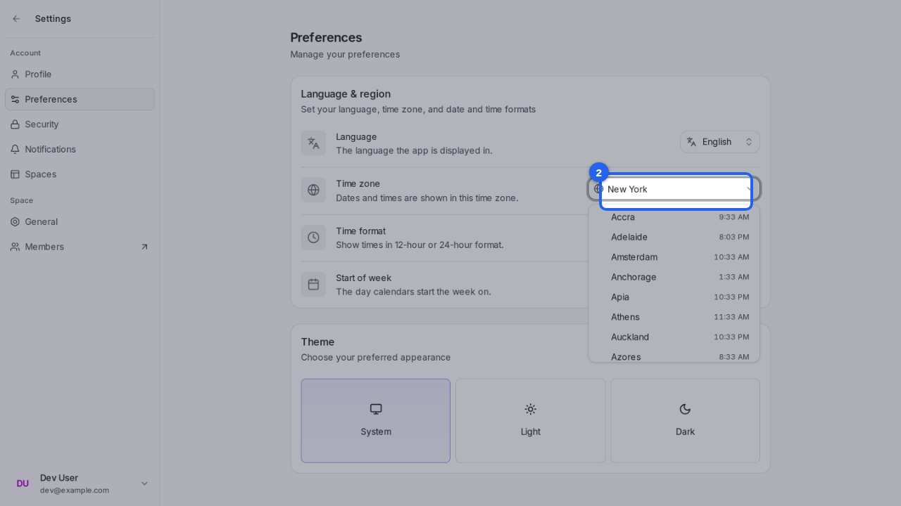
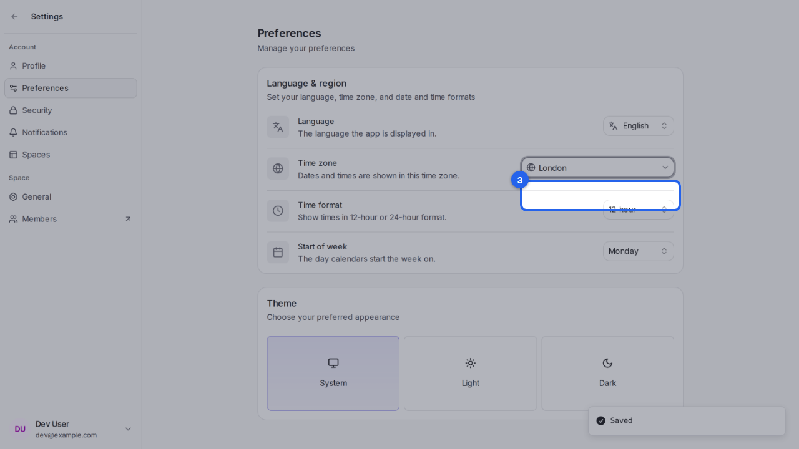
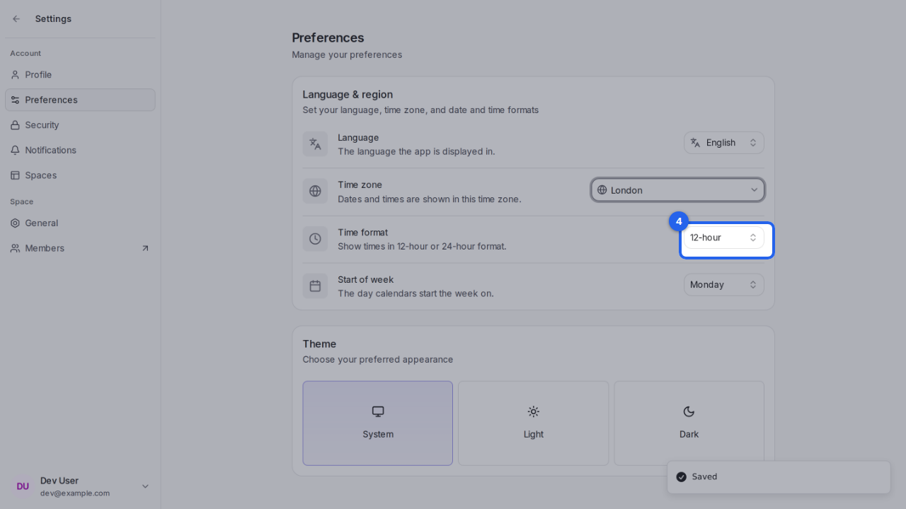

{/* aida:begin header */}
# Set your time zone and language

Choose the language, time zone and time format Rallly uses for you. This guide is for organizers.
{/* aida:end header */}

{/* aida:begin before-you-start */}
## Before you start

- Sign in as **an organizer**.
{/* aida:end before-you-start */}

{/* aida:begin steps-heading */}
## Steps
{/* aida:end steps-heading */}

{/* aida:begin step-open-preferences */}
#### 1. Open Preferences

Open **Settings**, then **Preferences**.

{/* aida:end step-open-preferences */}

{/* aida:begin step-open-time-zone */}
#### 2. Open the time zone list

Rallly shows every time in your own time zone. Select **Time zone** to change it.

{/* aida:end step-open-time-zone */}

{/* aida:begin step-pick-time-zone */}
#### 3. Pick your time zone

Type the name of a nearby city, then select it.

{/* aida:end step-pick-time-zone */}

{/* aida:begin step-time-format */}
#### 4. Choose 12-hour or 24-hour time

Use **Time format** and **Start of week** the same way. Changes are saved as you make them.

{/* aida:end step-time-format */}

{/* aida:begin last-checked */}
---

*Steps verified against the real app on 2026-10-28.*
{/* aida:end last-checked */}
