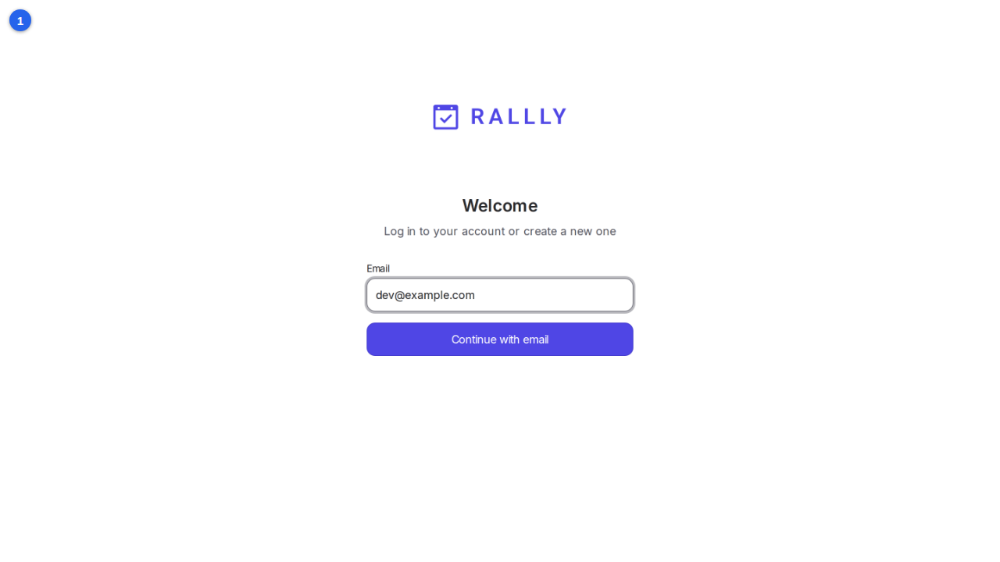
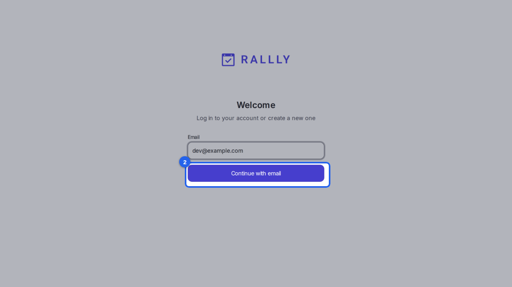
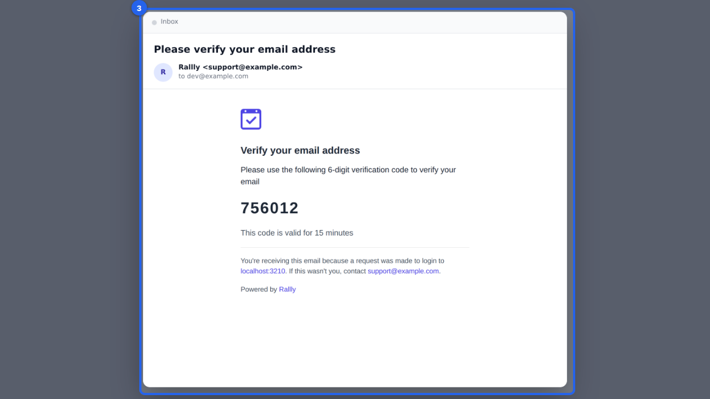
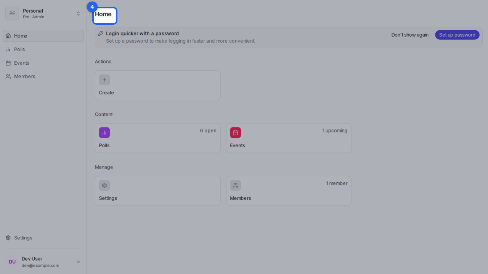

{/* aida:begin header */}
# Sign in

Sign in with a one-time code sent to your email. There's no password to remember. This guide is for organizers.
{/* aida:end header */}

{/* aida:begin steps-heading */}
## Steps
{/* aida:end steps-heading */}

{/* aida:begin step-enter-email */}
#### 1. Enter your email address

Open the sign-in page and type your email address in **Email**.

{/* aida:end step-enter-email */}

{/* aida:begin step-continue */}
#### 2. Continue

Select **Continue with email**. Rallly sends a one-time code to that address.

{/* aida:end step-continue */}

{/* aida:begin step-open-email */}
#### 3. Find the code in your email

Open the email from Rallly. It holds a six-digit code that works for 15 minutes. Can't see it? Check your spam or junk folder.

{/* aida:end step-open-email */}

{/* aida:begin step-enter-code */}
#### 4. Enter the code

Back on the sign-in page, type the code in **Enter your 6-digit code**. Rallly signs you in as soon as the code is complete, and opens your home page.

{/* aida:end step-enter-code */}

{/* aida:begin last-checked */}
---

*Steps verified against the real app on 2026-10-28.*
{/* aida:end last-checked */}
