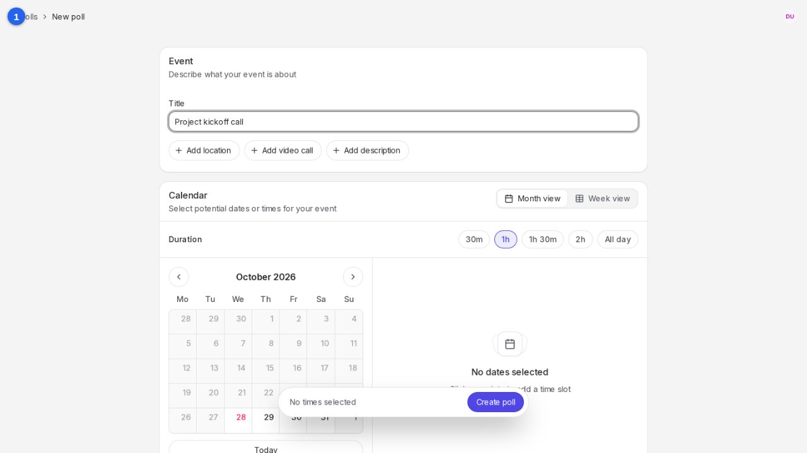
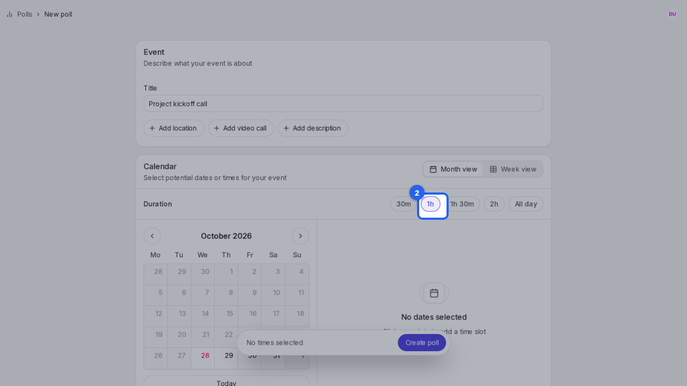
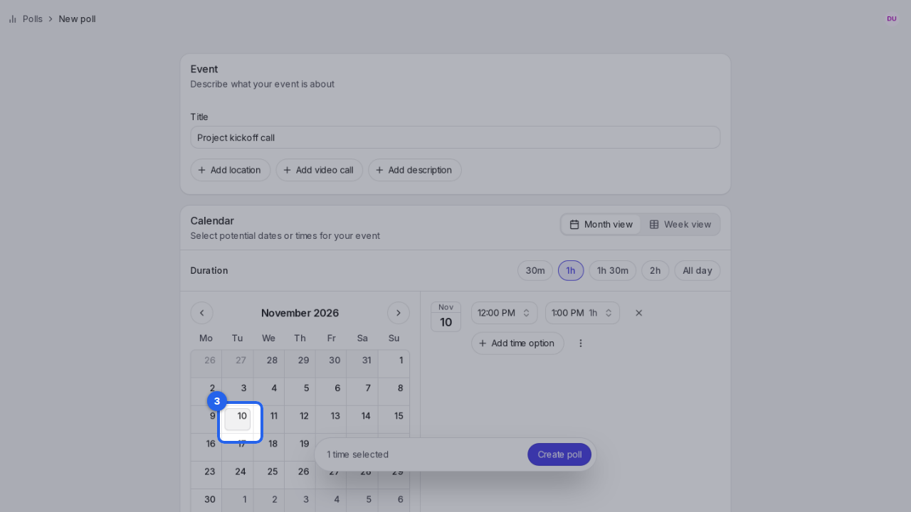
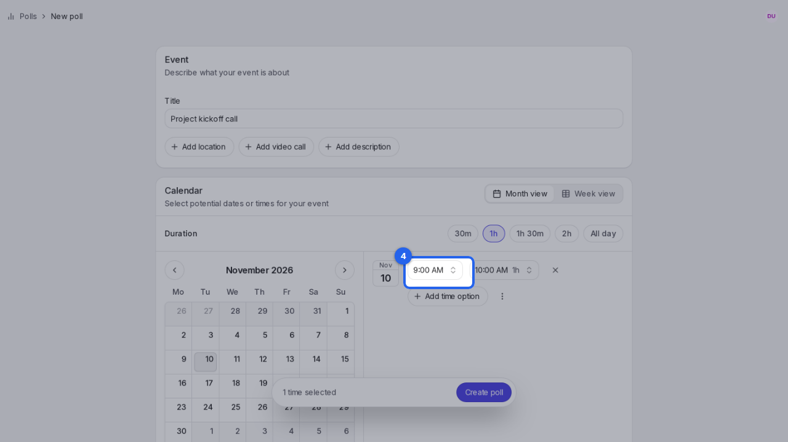
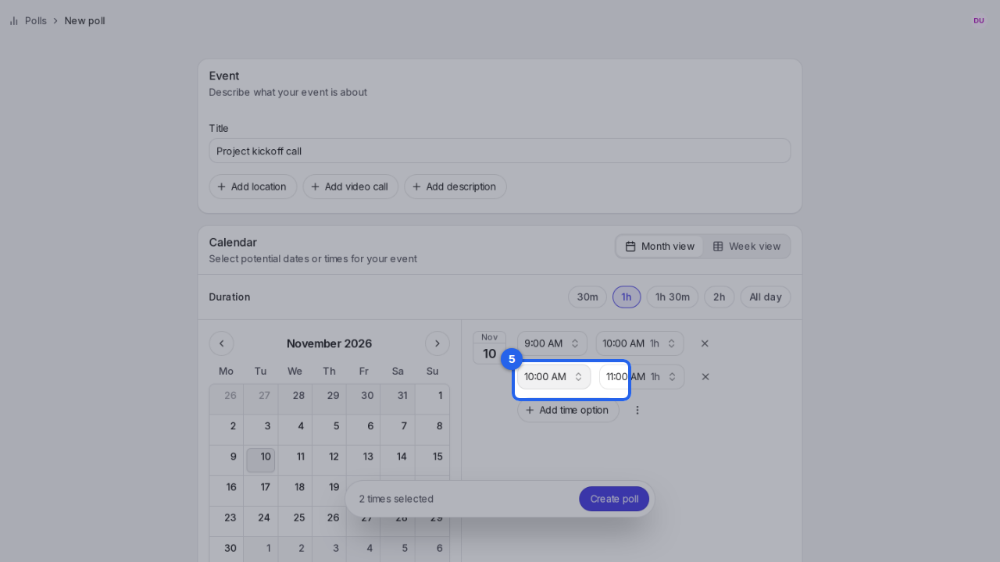
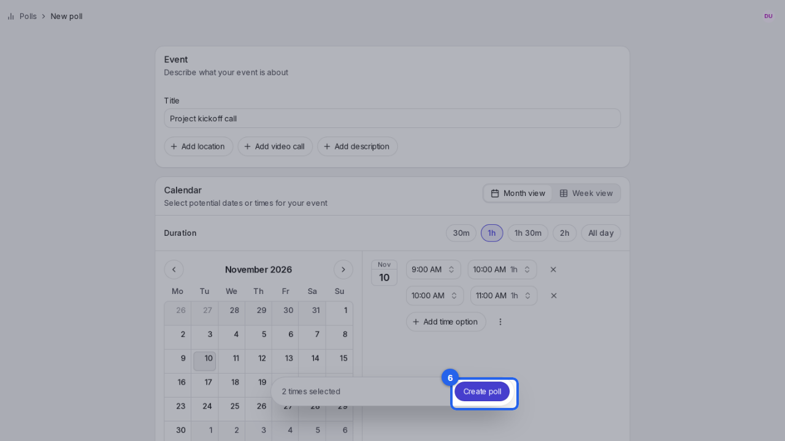

{/* aida:begin header */}
# Suggest times, not just dates

Offer start times on each date, so people can say which time of day works too. This guide is for organizers.
{/* aida:end header */}

{/* aida:begin before-you-start */}
## Before you start

- Sign in as **an organizer**.
{/* aida:end before-you-start */}

{/* aida:begin steps-heading */}
## Steps
{/* aida:end steps-heading */}

{/* aida:begin chapter-1 */}
### Part 1: Set up the poll
{/* aida:end chapter-1 */}

{/* aida:begin step-name-it */}
#### 1. Name the event

Start a new poll and type a title in **Title**.

{/* aida:end step-name-it */}

{/* aida:begin step-pick-length */}
#### 2. Choose how long it lasts

Under **Duration**, choose how long the event lasts, such as **1h**. With a length chosen instead of **All day**, each date gets a start time.

{/* aida:end step-pick-length */}

{/* aida:begin chapter-2 */}
### Part 2: Add times
{/* aida:end chapter-2 */}

{/* aida:begin step-pick-date */}
#### 3. Pick a date

Move to the month you want and click a date. It's added to the list with a start time.

{/* aida:end step-pick-date */}

{/* aida:begin step-set-time */}
#### 4. Set the start time

Select the start time and choose a new one. The end time moves with it, keeping the length you picked.

{/* aida:end step-set-time */}

{/* aida:begin step-add-another-time */}
#### 5. Add another time on the same day

To offer more than one time on the same date, select **Add time option**.

{/* aida:end step-add-another-time */}

{/* aida:begin chapter-3 */}
### Part 3: Create the poll
{/* aida:end chapter-3 */}

{/* aida:begin step-create */}
#### 6. Create the poll

Select **Create poll**. Each person sees the times in their own time zone, unless you turn on **Lock time zone**.

{/* aida:end step-create */}

{/* aida:begin last-checked */}
---

*Steps verified against the real app on 2026-10-28.*
{/* aida:end last-checked */}
