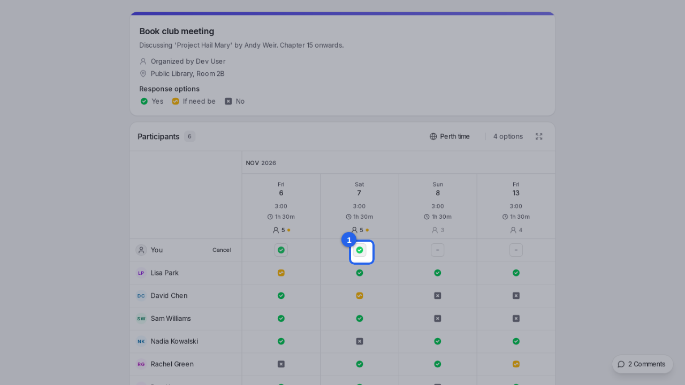
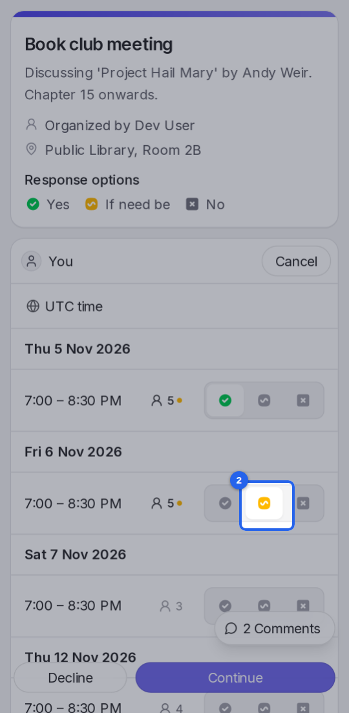
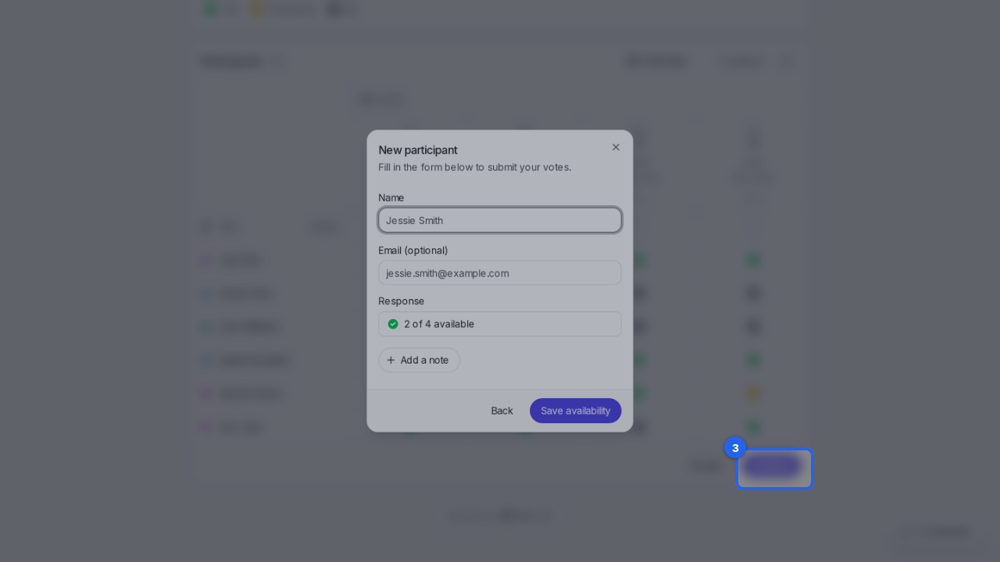
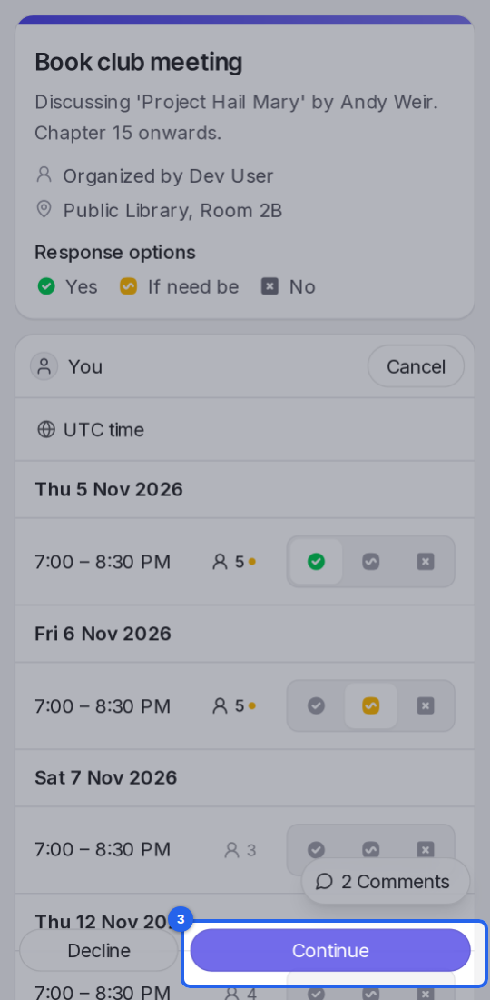
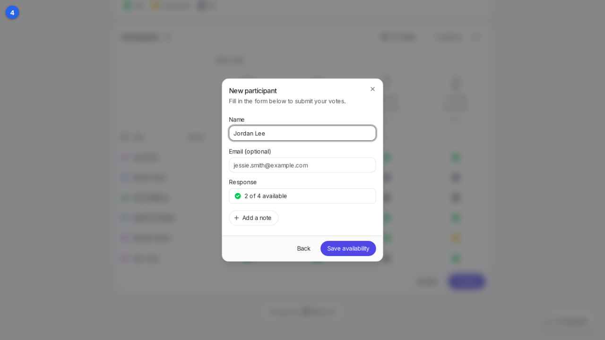
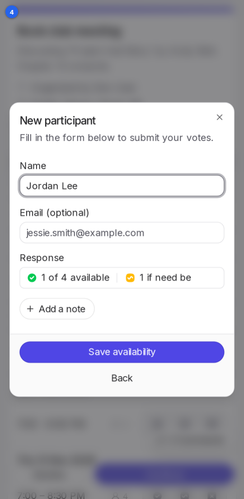
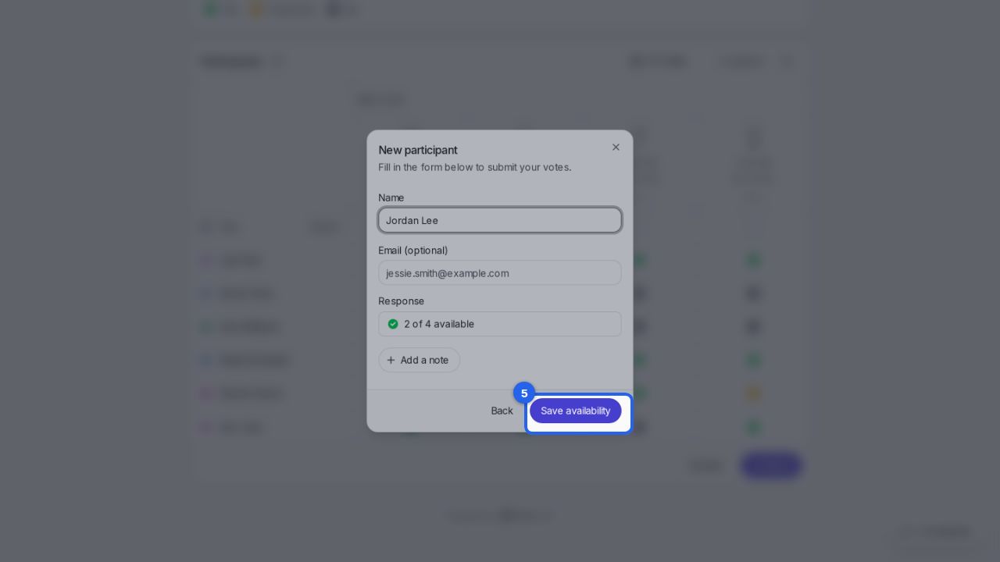
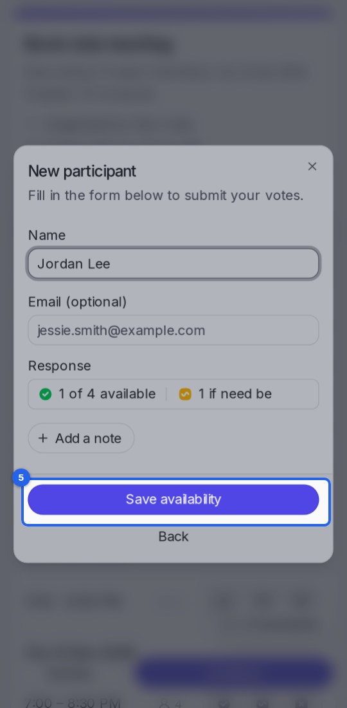
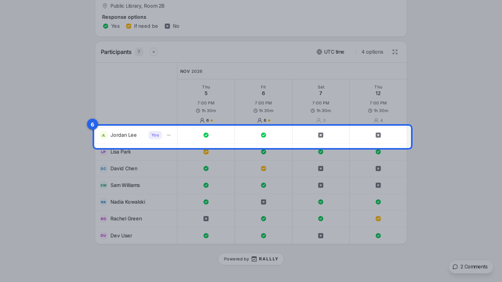
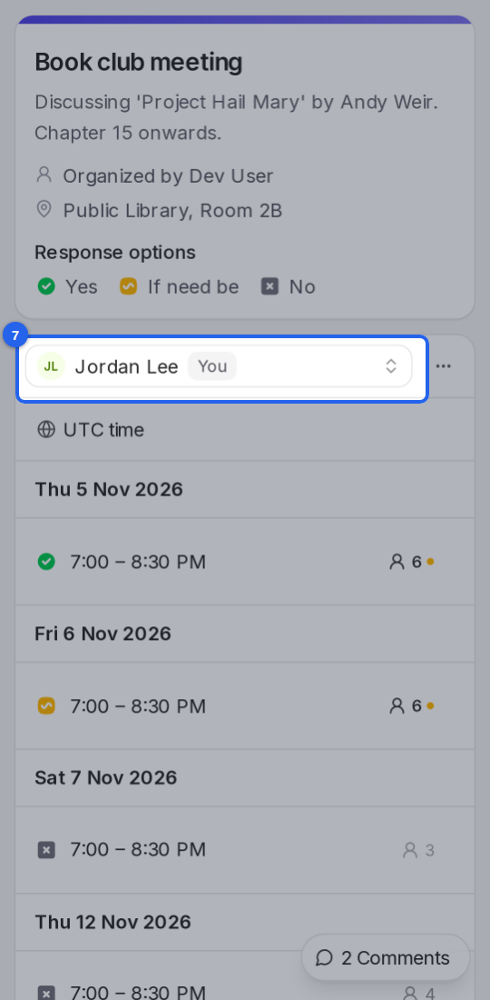

{/* aida:begin header */}
# Say when you're free

Open the invite link, mark the dates that work for you, and add your name. This guide is for people invited to a poll.
{/* aida:end header */}

{/* aida:begin steps-heading */}
## Steps
{/* aida:end steps-heading */}

{/* aida:begin chapter-1 */}
### Part 1: Mark your dates
{/* aida:end chapter-1 */}

{/* aida:begin step-mark-dates */}
#### 1. Mark the dates that work

Open the invite link you were sent. In the **You** row at the top, click each date that works for you. Click once for **Yes**, twice for **If need be** and three times for **No**.

*On a computer only.*

{/* aida:end step-mark-dates */}

{/* aida:begin step-mark-dates-phone */}
#### 2. Mark the dates that work

Open the invite link you were sent. Under each date, tap **Yes**, **If need be** or **No**.

*On a phone only.*

{/* aida:end step-mark-dates-phone */}

{/* aida:begin step-continue */}
#### 3. Continue

Select **Continue** below the table.

<DeviceShots devices="desktop,phone">

</DeviceShots>
{/* aida:end step-continue */}

{/* aida:begin chapter-2 */}
### Part 2: Save your answer
{/* aida:end chapter-2 */}

{/* aida:begin step-add-your-name */}
#### 4. Add your name

In **Name**, type your name. Adding your email is optional; it lets Rallly tell you when a date is picked.

<DeviceShots devices="desktop,phone">

</DeviceShots>
{/* aida:end step-add-your-name */}

{/* aida:begin step-save */}
#### 5. Save your availability

Select **Save availability**. Rallly confirms your response has been saved.

<DeviceShots devices="desktop,phone">

</DeviceShots>
{/* aida:end step-save */}

{/* aida:begin step-see-your-row */}
#### 6. See your answers in the poll

Select **Back to poll**. Your name and answers now show in the poll with everyone else's. To change them later, open the same link again.

*On a computer only.*

{/* aida:end step-see-your-row */}

{/* aida:begin step-see-your-answers-phone */}
#### 7. See your answers in the poll

Select **Back to poll**. Your name shows at the top of the poll, with your answer beside each date. To change them later, open the same link again.

*On a phone only.*

{/* aida:end step-see-your-answers-phone */}

{/* aida:begin last-checked */}
---

*Steps verified against the real app on 2026-11-08.*
{/* aida:end last-checked */}
